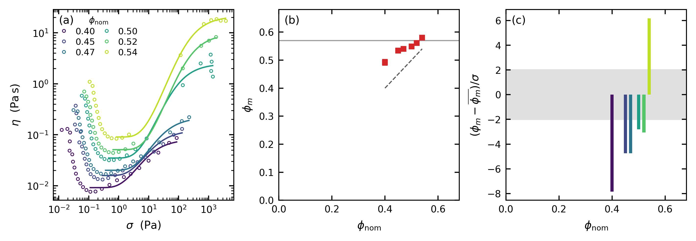

# dst-fit

Constitutive identification for dense and shear-thickening suspensions, with an
identifiability verdict attached to every fit.

Existing rheology packages (pyRheo, hermes-rheo, RepTate) target polymer
viscoelasticity: creep, relaxation, SAOS, fractional models. None of them fit
volume-fraction-dependent thickening, so there is nothing that takes a flow
curve and returns phi_m, phi_0 or sigma*. That is the gap this fills.

The part that matters is the second half. Fitting a four-parameter closure to a
single flow curve almost always succeeds and often means nothing, because the
parameters trade off against each other. `dst-fit` is built to say so.

## Status

Units N1 to N7 of the spec are done, plus G4, G5 and G10. Six gates pass, four
fail, and the four failures are the result rather than a blocker.

**What running all ten established, in one paragraph.** Wyart-Cates has two
halves and they do not fare the same. Its **onset stress is real**: `sigma*`
inferred from the curvature of a flow curve agrees within a factor of two with
an independent shear-reversal measurement of where frictional contacts take
over, on two different materials (G10). Its **jamming fraction is not
measurable from one flow curve**: `phi` and `phi_m` enter only through
`phi/phi_J`, so near jamming a curve pins the ratio and neither number, and
independent fits of one material return `phi_m` values that no single value can
reconcile (N4, N6, G4). That is not an error-bar artefact: profile likelihood
and a correlation-aware block bootstrap widen the intervals by at most 1.8x
where 9x to 14x would be needed (N7).

```
src/dst_fit/io_trios.py         TRIOS flow-sweep reader
src/dst_fit/io_literature.py    the three DataShare deposits and their published constants
src/dst_fit/models.py           five constitutive models, all eta(sigma)
src/dst_fit/fitting.py          multi-start least squares with linearised uncertainty
src/dst_fit/identifiability.py  degeneracy, misspecification, cross-curve consistency
src/dst_fit/profiling.py        profile likelihood, block bootstrap, interval intersection
src/dst_fit/joint.py            whole-series fit with shared phi_m, phi_0, sigma*
scripts/gate_n1.py              N1 gate: ingest and units
scripts/gate_n2.py              N2 / G1 gate: recovery, coverage, censoring
scripts/gate_n3.py              N3 / G2 gate: misspecification, with its control
scripts/gate_n4.py              N4 / G3 gate: the 2023 corn-starch series. FAILS
scripts/gate_n5.py              N5 / G6 gate: does sharing rescue it? FAILS
scripts/gate_n6.py              N6 / G7 gate: Richards et al.'s corn starch. FAILS harder
scripts/gate_n7.py              N7 / G9 gate: were the error bars wrong? PASSES, and they were not
scripts/gate_g4.py              G4 gate: Guy et al.'s PMMA. G4a and G4b pass, G4c FAILS
scripts/gate_g5.py              G5 gate: refusal on data that cannot answer
scripts/gate_g10.py             G10 gate: sigma* against a measured contact fraction. PASSES
scripts/make_fig_phim_drift.py  the headline figure
figures/                        fig_phim_drift.png plus the .md that explains it
tests/                          205 tests, several against real deposited data
```

## Install and run

```
pip install -e ".[dev]"
python -m pytest tests -q          # 205 passed
python scripts/gate_n1.py          # 0
python scripts/gate_n2.py          # 0
python scripts/gate_n3.py          # 0
python scripts/gate_n4.py          # 1  <- the result, not a regression
python scripts/gate_n5.py          # 1  <- the result, not a regression
python scripts/gate_n6.py          # 1  <- the result, not a regression
python scripts/gate_n7.py          # 0  (~3 min; 100 profiles and 100 bootstraps)
python scripts/gate_g4.py          # 1  <- G4a and G4b pass, G4c is the result
python scripts/gate_g5.py          # 0
python scripts/gate_g10.py         # 0
```

`gate_n6`, `gate_n7`, `gate_g4` and `gate_g10` need the DataShare deposits,
which are not in the repository. `DATA_INVENTORY.md` says what they are and
where to get them.

## Fixed constants are per dataset, not per module

Wyart-Cates here has three fitted parameters (`phi`, `phi_m`, `sigma_star`) and
four fixed constants (`eta_s`, `phi_0`, `n`, `beta`). Until 2026-08-27 all four
were module-level constants carrying corn-starch-in-water values, which silently
mis-stated every literature comparison. They are now bound per dataset:

```python
from dst_fit import fit_model
from dst_fit.io_literature import GUY_PMMA_3770
from dst_fit.models import WYART_CATES

model = WYART_CATES.with_fixed(**GUY_PMMA_3770.as_fixed())
model.describe_fixed()   # 'eta_s=0.00283, phi_0=0.6123, n=2.2, beta=1'
fit = fit_model(model, stress, viscosity, branch=branch)
```

The module defaults are unchanged and pinned by test, so every result recorded
before the change still reproduces. `with_fixed` refuses a name the model does
not take, and setting `phi_0` also lowers the `phi` and `phi_m` bounds, because
both must stay below the frictionless packing fraction.

Getting these wrong is not a rounding error. Data generated at Guy et al.'s
constants and fit at the old defaults returns a `phi_m` wrong by more than five
times its own error bar; there is a test that asserts exactly that.

## Saying how uncertain a parameter really is

```python
from dst_fit.profiling import profile_likelihood, block_bootstrap, interval_intersection

pr = profile_likelihood(model, stress, viscosity, "phi_m", branch=br, fit=fit)
pr.bounded        # False when the data does not close the interval at all
pr.widening       # how many times wider than the Wald interval
print(pr.summary())

bs = block_bootstrap(model, stress, viscosity, "phi_m", branch=br, fit=fit)
bs.block_length   # taken from the observed number of residual sign runs
```

`profile_likelihood` follows the real cost surface, so it reports asymmetry and
refuses to invent a limit where the data does not provide one. `block_bootstrap`
drops the independent-residuals assumption that both the Wald and the profile
interval share. `interval_intersection` then asks whether one value of a shared
constant is compatible with every curve, which needs neither a weighted mean nor
a Gaussian.

## Reading a sweep

```python
from dst_fit import read_series, check_stress_consistency

sweeps = read_series(sorted(data_dir.glob("*_e1.xls")))   # sorted by phi
s = sweeps[0]
s.shear_rate     # 1/s
s.viscosity      # Pa.s
s.stress         # Pa, recomputed as eta * gamma_dot
s.phi            # 0.40, parsed from the filename
check_stress_consistency(s)    # cross-check on the unit interpretation
```

Everything comes back in SI. The reader refuses to guess: an unrecognised unit,
a missing column, or a non-positive rate or viscosity raises with a message
naming the file and what it found.

## Why stress is recomputed rather than read

TRIOS exports stress in MPa. Nothing is lost (the column carries six significant
figures) but a dense-suspension sweep then lives around 1e-8 to 1e-4 in the
stored numbers, so anything that prints or thresholds the raw column sees a row
of zeros. Reading one of these files with a default `head()` shows exactly that,
and it is a display artifact, not the data.

Stress is therefore recomputed from the two independent columns as
`eta * gamma_dot`, which is an identity for steady simple shear rather than a
model. The exported column is kept and compared against the reconstruction,
which is a real test of the unit interpretation: misreading MPa as Pa shows up
as a factor of 1e6. On the corn-starch series the two agree to 7.6e-6 relative.

## Gate N1, as run

Pass conditions were fixed before the run.

| Gate | Condition | Result |
|---|---|---|
| N1a | Six files load with the expected schema | PASS, phi = 0.40 to 0.54 |
| N1b | `eta * gamma_dot` matches the exported stress to <1% | PASS, worst 7.6e-6, 1318x margin |
| N1c | Positive, finite, isothermal within 1 degC of 25 | PASS |

## What the data turned out to look like

Not gated, recorded because it shapes N2.

| phi | n | gamma_dot range (1/s) | eta_min (Pa.s) | thickening |
|---|---|---|---|---|
| 0.40 | 25 | 0.099 to 993 | 0.0077 | 11.3x |
| 0.45 | 25 | 0.098 to 994 | 0.0133 | 9.8x |
| 0.47 | 25 | 0.100 to 995 | 0.0170 | 13.0x |
| 0.50 | 25 | 0.099 to 996 | 0.0318 | 43.4x |
| 0.52 | 21 | 0.099 to **214** | 0.0444 | 186.7x |
| 0.54 | 21 | 0.098 to **214** | 0.0840 | 205.6x |

Two things follow for the fitting work, and the first of them reverses what the
rate axis appears to say.

**The rate truncation is not the censoring problem it looks like.** phi = 0.52
and 0.54 stop at 214 1/s while the others reach ~995, which invites the
conclusion that the two most informative curves were cut short. Measured on the
stress axis, where the model actually lives, the opposite is true: their
thickening branches span 3.44 and 3.65 decades of stress, the widest of the six,
against 2.66 to 3.47 for the four that ran to full rate. Thickening makes stress
climb superlinearly with rate, so those sweeps reach 1774 and 3698 Pa despite
stopping at a fifth of the rate.

| phi | branch points | sigma range on branch (Pa) | decades | gamma_dot max (1/s) |
|---|---|---|---|---|
| 0.40 | 12 | 0.112 to 86.0 | 2.89 | 993 |
| 0.45 | 11 | 0.285 to 130.3 | 2.66 | 994 |
| 0.47 | 11 | 0.364 to 220.7 | 2.78 | 995 |
| 0.50 | 12 | 0.464 to 1376.2 | 3.47 | 996 |
| 0.52 | 8 | 0.648 to 1773.7 | 3.44 | **214** |
| 0.54 | 9 | 0.836 to 3697.8 | 3.65 | **214** |

What the high-phi sweeps really have is *fewer points on the branch*, 8 and 9
against 11 and 12, which is a milder and different problem. Judging censoring by
the rate axis when the model is parameterised by stress was the mistake.

**The stress at minimum viscosity climbs with phi** (0.11, 0.29, 0.36, 0.46,
0.65, 0.84 Pa). It is tempting to read that as sigma*, and it should not be: the
viscosity minimum sits where the thinning branch gives way to the thickening
one, so it moves with the thinning physics too. Whether sigma* is actually
phi-independent here is a question for a real fit.

## Models and fitting (N2)

Four models, all written as `eta(sigma)`. Stress rather than shear rate because
a DST flow curve `sigma(gamma_dot)` is S-shaped and multivalued while its
inverse is single-valued, so rate space would break the model on the one case
that matters.

| Model | Parameters | Describes |
|---|---|---|
| `wyart_cates` | phi, phi_m, sigma_star | thickening and jamming, **no thinning branch** |
| `herschel_bulkley` | tau_y, k, n | yield stress plus power law |
| `ellis` | eta_0, eta_inf, sigma_c, a | thinning (stress form of Cross) |
| `maron_pierce` | phi, phi_m | the null model, no stress dependence at all |

Wyart-Cates has no thinning branch, so fitting it to a whole corn-starch sweep
is a category error. Use `thickening_branch()` to cut at the viscosity minimum
and pass the result to `fit_model(..., branch=...)`, which records the cut on
the result. Where that cut falls changes the recovered sigma*, so it travels
with the fit rather than being buried.

```python
from dst_fit.fitting import fit_model
from dst_fit.models import thickening_branch

br = thickening_branch(s.viscosity)
r = fit_model("wyart_cates", s.stress, s.viscosity, branch=br)
print(r.summary())
```

Uncertainty is the linearised `cov = s^2 (J^T J)^-1`. It is a local Gaussian
approximation and optimistic where the model is strongly nonlinear, so the
correlation matrix is returned with it: `r.worst_correlation()` reports the
tightest parameter trade-off. Turning that into a verdict is N3.

## Gate N2 / G1, as run

| Gate | Condition | Result |
|---|---|---|
| G1a | Median relative recovery error < 5%, every parameter | PASS, worst 0.020 |
| G1b | 2-sigma interval covers the truth in >= 80% of 100 trials | PASS, 0.93 to 0.97 against a nominal 0.954 |
| G1c | RETIRED after **failing** | see below |
| G1c' | Truncation must cost `phi_m` more than `phi` at every cut | PASS at all three cuts |

G1b is the point of the exercise. Recovering a parameter once proves only that
the optimiser works; `diff_calibrate.py` in the tier-0 repo does that and it
means very little. Coverage near nominal means the quoted error bars can be
believed.

**G1c failed and is recorded rather than deleted.** It asked that removing the
top 20% of the stress range inflate the `sigma_star` standard error by at least
3x. Measured: 1.14x. The gate named the wrong parameter. `sigma_star` is set by
where the frictional transition sits, which the retained data still brackets;
the high-stress plateau is what constrains `phi_m`. Under progressive
truncation:

| retained | sigma_max (Pa) | phi | phi_m | sigma_star |
|---|---|---|---|---|
| 80% | 94.3 | 0.99x | 1.31x | 1.14x |
| 60% | 8.9 | 1.10x | 8.52x | 2.85x |
| 50% | 2.7 | 1.13x | 154.70x | 14.11x |

The fitter was behaving correctly throughout. G1c' replaces the magnitude
threshold with the structural claim that `phi_m` must lose more precision than
`phi` at every cut, which follows from what each parameter reads off the curve
and so cannot be tuned to make a run pass.

## Identifiability and specification (N3)

Two questions a fit can fail separately, and the reason the package exists.

**Is the model even right?** A model that cannot make the shape of the data
still returns parameters, with error bars. The tell is not the size of the
residuals but their structure: a correct model leaves residuals that flip sign
like coin tosses, a wrong one leaves long runs of one sign. The Wald-Wolfowitz
runs test finds that without needing to know the measurement noise, which
matters because the noise is usually not known.

**Do the parameters mean anything individually?** A small standard error means
the optimum is sharp along that axis, not that the parameter is pinned. Two
parameters trading off produce a long flat valley in which both marginal errors
still look small. Pairs above |r| = 0.95 are named and the caller is told not to
quote them separately.

```python
from dst_fit import assess, fit_model
a = assess(fit_model("wyart_cates", s.stress, s.viscosity, branch=br))
a.usable          # identifiable and well specified
print(a.verdict())
```

The verdict is text, not a score:

```
herschel_bulkley does not describe this data. The residuals change sign 5 times
where 21 would be expected by chance (p = 1.6e-07), so the misfit is systematic
rather than noise. The parameters below are what least squares returned; they
are not measurements of anything.
```

## Gate N3 / G2, as run

The half that is easy to forget is the control. A detector that flags everything
passes the interesting half of this gate and is worthless, so both directions
were pre-registered.

| Gate | Condition | Result |
|---|---|---|
| G2a | Every cross-model fit comes back not-usable | PASS, 6 of 6 flagged |
| G2b | Every self-fit comes back usable | PASS, 3 of 3 |
| G2c | Runs test fires on <= 5 of 50 correctly specified fits | PASS, 0 / 1 / 0 |

Generated by row, fit by column:

| generated | wyart_cates | herschel_bulkley | ellis |
|---|---|---|---|
| wyart_cates | usable | struct | struct |
| herschel_bulkley | struct | usable | struct, degen |
| ellis | struct | struct | usable |

## The result, in one figure



Six flow curves, six Wyart-Cates fits, and a `phi_m` that climbs from 0.492 to
0.580 where the model says it is a constant. Panel (b) shows the drift is small
in absolute terms, 0.09 on a quantity bounded near 0.64, with error bars too
small to see. Panel (c) rescales by those error bars: the same points span -7.8
to +6.2 sigma and none land inside the two-sigma band. Small and insignificant
are different things. `figures/fig_phim_drift.md` explains the panels and the
axis choices.

## Gate N4 / G3, as run: it failed

phi_m is the frictional jamming fraction, a property of the particles rather
than of how many of them are in the pot. Six fits of the same corn starch at six
volume fractions therefore have to return the same phi_m. They do not.

| phi nominal | n | phi fitted | phi_m | sigma* (Pa) | rmse | verdict |
|---|---|---|---|---|---|---|
| 0.40 | 12 | 0.4406 +/- 0.0086 | 0.4921 +/- 0.0099 | 2.08 +/- 0.48 | 0.155 | usable |
| 0.45 | 11 | 0.4884 +/- 0.0067 | 0.5338 +/- 0.0076 | 3.95 +/- 0.91 | 0.143 | usable |
| 0.47 | 11 | 0.5052 +/- 0.0058 | 0.5397 +/- 0.0063 | 5.70 +/- 1.16 | 0.144 | usable |
| 0.50 | 12 | 0.5378 +/- 0.0075 | 0.5482 +/- 0.0076 | 6.86 +/- 2.11 | 0.253 | degenerate |
| 0.52 | 8 | 0.5554 +/- 0.0029 | 0.5609 +/- 0.0029 | 11.30 +/- 1.80 | 0.104 | degenerate |
| 0.54 | 9 | 0.5765 +/- 0.0017 | 0.5803 +/- 0.0017 | 10.36 +/- 1.00 | 0.075 | degenerate |

**0 of 6 within 2 sigma of the weighted mean. Reduced chi-squared 32.4 on 5 dof.**
The pre-registered bar was 4 of 6, and it was not revised after seeing this.

The failure is not noise, and it is not the degeneracy predicted above. phi_m
climbs monotonically with phi, from 0.492 to 0.580. The obvious escape, that the
data only constrains the combination `phi_m - phi`, does not hold either: that
distance is well determined per curve (errors of 0.0001 to 0.0041) and it also
varies, from 0.0515 down to 0.0038, chi-squared 521 on 5 dof for a common value.
Something real is moving.

Two things sharpen the reading rather than explaining it away.

**The fitter recovers the label.** Fitted phi against nominal phi gives slope
0.970, intercept +0.052, r2 = 0.99925. The nominal fraction is the only external
reference available and the fit reproduces it from curve shape alone, with a
constant offset in the direction corn-starch granules are known to go, since
they swell in water. So the fit is not confused about the data.

**The degeneracy appears only at high phi.** r(phi, phi_m) runs 0.910, 0.891,
0.916 for the lower three and 0.995, 0.994, 0.998 for the upper three. Close to
jamming the two parameters stop being separable, which is why the top three
curves are flagged and the bottom three are not.

Candidate explanations, none yet tested, listed so the next unit does not have
to rediscover them:

1. `phi_0` and `eta_s` are held fixed at 0.64 and the viscosity of water. Corn
   starch granules are polydisperse, non-spherical and swollen, so 0.64 is
   probably wrong, and a wrong `phi_0` is absorbed by `phi_m`.
2. Granule swelling depends on available water, so at higher nominal phi each
   granule swells less. That would make the effective packing genuinely
   concentration-dependent, and phi_m would not be a constant for this material.
3. The nominal figure may be a mass fraction with a concentration-dependent
   conversion to volume.
4. The branch cut at the viscosity minimum is a choice, and sigma* moves with it.

`sigma*` also spans 2.08 to 11.30 Pa, a factor of 5.4, where Wyart-Cates expects
it to be set by the repulsive force scale and so phi-independent. That is a
second failure of the same kind and points the same way.

### Why this is the useful outcome

A package that printed six phi_m values with their error bars would have looked
like six precise measurements of a material constant. Every individual fit here
is good: residuals consistent with noise on all six, rmse between 0.075 and
0.253 in log viscosity. The problem is only visible when the six are asked to
agree, and the answer is that at most one of them is measuring a material
property.

That is the sentence this package exists to produce, and it arrived on the first
real dataset it was pointed at.

## Gate N5 / G6, as run: sharing does not rescue it

G3 failed because six fits returned six different `phi_m`. The cheapest
explanation was that `phi_0` had been pinned at 0.64, random close packing for
frictionless monodisperse spheres, which corn-starch granules are none of.
Because `phi_J = (1-f) phi_0 + f phi_m`, a wrong `phi_0` lands directly in
`phi_m`. So `joint.py` frees `phi_0`, forces one shared `phi_m` and `sigma*`
across all six curves, gives each curve only its own `phi`, and lets AIC decide.

| model | k | rmse (log eta) | AIC | phi vs nominal r2 |
|---|---|---|---|---|
| six independent fits | 18 | 0.1617 | **-193.6** | **0.99925** |
| joint, shared sigma* | 9 | 0.2891 | -138.4 | 0.95931 |
| joint, per-curve sigma* | 14 | 0.2661 | -138.8 | 0.96429 |

**The joint model loses by 55 AIC and the residual nearly doubles.** Pre-registered
G6b wanted AIC(joint) < AIC(independent) and G6d wanted the external phi check to
survive at r2 >= 0.99. Both fail. Freeing `phi_0` does not rescue a shared
`phi_m`, so the drift was never about `phi_0`.

One more thing the run showed, which the gate was too weak to catch. The shared
fit returns `phi_0 = 0.691 +/- 924` and `phi_m = 0.595 +/- 796`. Those errors are
not typos: with a shared `sigma*` the two packing fractions are almost perfectly
traded off, since they enter only through the same interpolation. G6a asked only
that the errors be *finite*, and finite is not the same as meaningful. The gate
passed on a fit that determines nothing. Recorded rather than quietly fixed; the
overall verdict does not depend on it, because G6b and G6d fail on their own.

### Where that leaves the corn starch

Three candidates survive from the spec, and the two that remain plausible are
versions of the same thing:

2. Granule swelling depends on available water, so at higher nominal phi each
   granule swells less and the effective packing genuinely moves. `phi_m` would
   then not be a constant for this material, and the model is not being refused
   so much as applied outside its assumptions.
3. The nominal figure may be a mass fraction whose conversion to volume is itself
   concentration-dependent, which produces the same signature.
4. The branch cut is a choice and `sigma*` moves with it. Testable through
   `thickening_branch(pad=...)`, and cheap, but it cannot produce a monotone
   `phi_m` drift of 0.492 to 0.580 on its own.

What the data says without a model on top of it: each curve determines its own
distance to jamming very precisely, the fitted `phi` reproduces the nominal label
at r2 = 0.99925, and the jamming point itself moves with concentration. For
swollen deformable granules that is physically unsurprising. It does mean corn
starch is a poor calibration standard for a package whose selling point is
recovering material constants.

**The product decision this forces.** `dst-fit` should ship validated against
silica, where the particles are hard, monodisperse and non-swelling, and carry
this corn-starch series as the worked example of the tool refusing a model. That
is a better demo than a clean fit would have been: it is the case where every
individual fit looks good and only the cross-curve consistency check catches the
problem.

## Gate G5, as run: refusing data that cannot answer

Least squares always returns a number and always attaches an error bar to it, so
a fitting package is most dangerous exactly where the data is too thin to say
anything.

| Gate | Condition | Result |
|---|---|---|
| G5a | Fewer points than parameters: raises | PASS |
| G5b | Newtonian data under Wyart-Cates: not usable | PASS, flagged degenerate |
| G5c | Monotone thinning data under Wyart-Cates: not usable | PASS |
| G5d | Stresses far below the transition: reported as not bracketing, sigma* relative error > 100% | PASS, 154% |
| G5e | Stresses far above the transition: reported as not bracketing | PASS |
| G5f | Control: bracketing data reported as bracketing, sigma* better than 50% | PASS, 2.1% |

G5f is why the other two mean anything. A checker that always cried wolf would
pass G5d and G5e on its own.

### What running it actually taught

`sigma*` does not run off to a bound when the data cannot constrain it. **It
migrates into whatever stress window you measured.** With a true `sigma*` of
5 Pa:

| window measured (Pa) | sigma* returned | relative error |
|---|---|---|
| 1e-4 to 1e-2 | 0.00599 | 154% |
| 1e3 to 1e5 | 5.27e4 | 124% |
| 0.1 to 1e3 | 5.41 | 2.1% |

Off by 1000x and 10000x, and in both cases the answer lands comfortably inside
the range the user swept. So *"my fitted sigma\* is in my measurement range"* is
not evidence of anything, because it is what happens either way. Only the
relative error and the coverage check separate the two situations.

`transition_coverage()` reports this as a property of the experiment rather than
of the fit, which makes it actionable in a way a covariance matrix is not:

```
the measured stresses sit below the transition rather than across it: the
frictional fraction only runs 0.00 to 0.55 over 0.0001 to 0.01 Pa. sigma* is not
measured here. The fit will still place it inside this window, because that is
what least squares does with an unconstrained parameter, so its apparent
plausibility carries no information. Extend the sweep to higher stress.
```

It deliberately does not say how many decades further to sweep. That number
would have to come from the fitted `sigma*`, which in this branch is precisely
what the data failed to determine, so quoting it would let the estimate set the
scale for the measurement meant to constrain the estimate.

---

## Gate N6 / G7, as run: the drift is corn starch, not the 2023 data

N4 left one question open. Six fits of one corn-starch series returned six
different `phi_m`, and nothing in that dataset could say whether the drift
belonged to corn starch or to that particular batch of measurements.

Richards, Royer, Liebchen, Guy & Poon, PRL 123, 038004 (2019) deposited seven
time-averaged flow curves of corn starch in 50 wt% glycerol-water. Different
lab, different solvent, different rheometer, different operator, and their own
published Wyart-Cates fit to compare against.

**They use weight fractions and say why**: "Here we use weight fractions, phi,
due to the porosity of our main model system (cornstarch)." So the
weight-to-volume conversion that was candidate (3) in the open questions is not
a conversion the source lab thinks is available. `phi_0 = 0.546` is their
measured frictionless jamming point in those units, not a fudge.

| Gate | Condition | Result |
|---|---|---|
| G7a | `phi_m` consistent across >= 4 of 7 curves within 2 sigma | **FAIL, 0 of 7** |
| G7b | weighted-mean `phi_m` within 0.02 of the published 0.457 | PASS, +0.0064 |

G7b passing is what makes G7a worth reading. The package lands on the published
number; it is the *spread* that fails, and it fails harder than on the 2023
series: reduced chi-squared **221 on 6 dof** against 32.4 on 5.

```
  phi 0.38   phi_m 0.4480 +/- 0.0010
  phi 0.40   phi_m 0.4475 +/- 0.0012
  phi 0.42   phi_m 0.4531 +/- 0.0017
  phi 0.44   phi_m 0.4593 +/- 0.0020
  phi 0.46   phi_m 0.4721 +/- 0.0014
  phi 0.48   phi_m 0.4870 +/- 0.0011
  phi 0.50   phi_m 0.5070 +/- 0.0023
```

Monotone in `phi`, same direction as the 2023 series.

### The check that needed no fitting

Take the authors' own five numbers, put the nominal weight fraction in for
`phi`, and ask how well their published curve describes their published data.

| phi | published-parameter rmse | per-curve fitted rmse |
|---|---|---|
| 0.38 | 0.082 | 0.019 |
| 0.42 | 0.129 | 0.068 |
| 0.44 | 0.239 | 0.109 |
| 0.46 | **2.022** | 0.102 |
| 0.48 | **1.200** | 0.081 |
| 0.50 | **0.600** | 0.150 |

Above phi = 0.46 the published parameters predict **shear jamming where the
material is still flowing** — 17 of 28 points at phi = 0.50. So the drift is not
this package over-freeing parameters. A single `(phi_m, sigma*)` genuinely does
not describe the series, and the paper's own Figure 1 is a visual fit that hides
where it stops working.

Forcing one `phi_m` and one `sigma*` with `phi` still free, N5's control applied
here, loses to independent fits by **568 AIC** (rmse 0.092 to 0.408). On the 2023
series the same comparison lost by 55.

### What the constants do and do not change

| constants | weighted-mean phi_m | spread | reduced chi2 |
|---|---|---|---|
| as published, phi_0 = 0.546, beta = 0.94 | 0.4634 | 0.4475 to 0.5070 | 221.1 |
| beta = 1.0 | 0.4678 | 0.4496 to 0.5084 | 185.4 |
| phi_0 = 0.64 | 0.5432 | 0.5245 to 0.5942 | **221.1** |
| phi_0 = 0.64 and beta = 1.0, the pre-refactor code | 0.5483 | 0.5270 to 0.5959 | 185.4 |

`phi_0` moves the *level* of `phi_m` by 0.08 and leaves the reduced chi-squared
bit-for-bit unchanged. Candidate (1), a wrong `phi_0`, is dead for a second time
and on somebody else's data.

---

## Gate G4, as run: the control fails too, and that is the finding

If the consistency rule failed on corn starch and passed on hard spheres, the
answer would be "corn starch is not a Wyart-Cates material". Guy, Hermes & Poon
2015 is that control: PHSA-stabilised PMMA, monodisperse, non-porous,
non-swelling, density matched, two sizes 9.3x apart, and the paper's own
`phi_m = 0.558(5)`.

| Gate | Condition | Result |
|---|---|---|
| G4a | refit their deposited `eta_2(phi)` branch, recover `phi_m` within 0.02 | **PASS, +0.0003** |
| G4b | Wyart-Cates on the d = 3770 nm flow curves, weighted-mean `phi_m` within 0.02 | **PASS, -0.0151** |
| G4c | >= 4 of the admitted curves within 2 sigma of that mean | **FAIL, 1 of 6** |

G4a is exact. Refitting `eta_r = A(1 - phi/phi_c)^-n` to their six deposited
rows returns `phi_c = 0.5583 +/- 0.0054` and `n = 2.176 +/- 0.245` against their
published `0.558(5)` and `2.2(2)`. The fitter reproduces a published fit of the
same numbers to four decimal places, so G4c is not a fitter problem.

### Provenance, established from the numbers

Three things about this deposit were wrong or unverified in `DATA_INVENTORY.md`,
and all three would have gone into `phi_m`:

- **the file names do not match the panel letters.** `Fig1b.xlsx` is panel (c);
  `Fig1c.xlsx` is panel (b).
- **there are two solvent viscosities**, 2.4 mPa.s for the small particles and
  2.83 for the large. Dividing each workbook's lowest-stress viscosity by the
  matching tabulated `eta_1` returns the solvent viscosity directly: **2.35 to
  2.41 mPa.s for `Fig1a`, 2.66 to 2.81 for `Fig1b`**. That one check fixes the
  size assignment, the label-to-phi map and the solvent viscosity at once.
- **`sigma* = 200 Pa` belongs to d = 404 nm, not d = 3770 nm**, where it is
  ~2 Pa. Fitting both series independently gives a ratio of **68x** against the
  70x the paper's own `d^-1.9(1)` scaling predicts. Neither number entered the
  other.

### The actual mechanism

The free fits give this:

| phi | phi_m - phi | r(phi, phi_m) |
|---|---|---|
| 0.4096 | 0.1652 | +0.60 |
| 0.4666 | 0.1041 | +0.74 |
| 0.5101 | 0.0547 | +0.73 |
| 0.5363 | 0.0250 | +0.94 |
| 0.5613 | 0.0121 | +0.95 |
| 0.5824 | 0.0013 | +0.99 |

`phi` and `phi_m` enter Wyart-Cates only through `phi/phi_J`, so a curve
approaching jamming pins the *ratio* and says progressively less about either
number alone. The correlation runs to +0.99 and the fitted `phi_m` collapses
onto the fitted `phi`. The same table on the 2023 corn starch runs 0.0515 down
to 0.0038 with `r` from 0.891 to 0.998. Three datasets, two materials, one
signature.

Pinning `phi` at the value the authors measured, and fitting only
`(phi_m, sigma*)`, is the test of that reading:

| | free phi | phi pinned |
|---|---|---|
| pairwise agreement | 1 of 15 | **11 of 15** |
| reduced chi2 | 344 | **63** |
| phi_m range | 0.530 to 0.588 | 0.561 to 0.584 |
| rmse (log eta) | 0.016 to 0.324 | 0.248 to 0.471 |

Consistency improves fivefold, and the fit quality gets much worse. Both halves
matter. The free fit was buying its residuals by moving `phi` away from the
known volume fraction — by 0.035 at phi = 0.41 — and what it returned as `phi_m`
was never a measurement of the particles.

### What this means for the package

`phi_m` from a single flow curve is not identifiable unless `phi` is known
independently, and even then it does not come back constant. That is not a
negative result for `dst-fit`; it is the thing `dst-fit` exists to report, now
demonstrated on three real datasets including the one the model was built for.
`WYART_CATES_KNOWN_PHI` exists so the identifiable version of the question can
be asked.

Two caveats kept deliberately. The paper says "the flow in both (a) and (c) was
unsteady for phi >= 0.56, and points represent temporal averages", and reports
wall slip at all stresses below `phi_m` and massive wall slip above it. Those are
the 56% and 58% curves, which carry the two largest `phi_m`. They are **not**
excluded, because the admission rule was fixed before the run and says nothing
about steadiness; dropping them after seeing the result would be choosing the
answer. A steadiness criterion should be pre-registered next time, not inherited.

---

## Gate N7 / G9, as run: the error bars were not the problem

Every consistency failure so far rested on standard errors taken from the
Jacobian at the optimum, and those errors look indefensible on the curves
nearest jamming: one Guy et al. curve returns `phi_m = 0.5876 +/- 0.0013` from a
fit whose `phi_m - phi` is itself 0.0013. If the error bars are too small, there
is no disagreement to explain. Two things could be wrong with them, and they
needed separating.

| Gate | Condition | Result |
|---|---|---|
| G9a | 95% profile interval covers the truth in >= 80 of 100 synthetic trials | PASS, 95/100 |
| G9b | 95% block-bootstrap interval likewise | PASS, 95/100 |
| G9c | the intersection test returns an answer on >= 4 real curves | PASS |

All three methods cover at 95/100 with median widths of 0.0012, 0.0013 and
0.0011. None of them is wide by construction, which is what makes a
*disagreement* between them mean something.

### The cost surface is not the problem

`profile_likelihood()` re-minimises over the nuisance parameters at each fixed
`phi_m` and reads the interval off the F statistic, so it follows the real shape
of the cost surface. The expectation was that a model diverging as
`phi -> phi_J` would give a badly asymmetric surface and a much wider interval.

It does not. **Profile widening over Wald: 1.00 to 1.04 on all thirteen real
curves.** The quadratic approximation is right, the surface really is locally
parabolic in `phi_m`, and the small error bar is the correct answer to the
question it was asked.

That is a negative result and it is worth more than a positive one would have
been: it eliminates the interval arithmetic as an explanation and leaves only
the noise model.

### The noise model is a problem, but not a big enough one

The runs test rejects independent residuals on every real curve, with p from
2.8e-6 to 6.6e-3. `block_bootstrap()` resamples *blocks* of residuals, with the
block length taken from the observed number of sign runs (`n / n_runs`), so the
resamples reproduce the real run structure instead of assuming it away.

| | widening over Wald |
|---|---|
| profile | 1.00 to 1.04 |
| bootstrap, blocks of 1 (the independence assumption) | 0.8 to 1.0 |
| bootstrap, real blocks of 3 to 8 | **1.0 to 1.8** |

Blocks of 1 reproducing the Wald width is the control: the method can agree, so
its disagreement counts. Real blocks widen the intervals by up to 1.8x.

### And the spread survives all of it

`interval_intersection()` asks the question that needs no weighted mean and no
Gaussian assumption: is there a single `phi_m` inside every curve's interval?

| series | intervals used | verdict |
|---|---|---|
| Guy PMMA, 6 curves | profile | no; gap 0.0523, at most 2 of 6 agree |
| Guy PMMA, 6 curves | block bootstrap | no; gap 0.0508, at most 2 of 6 agree |
| Richards corn starch, 7 curves | profile | no; gap 0.0516, at most 3 of 7 agree |
| Richards corn starch, 7 curves | block bootstrap | no; gap 0.0482, at most 3 of 7 agree |

The gate computes what it would take to reconcile them, rather than leaving it
to be eyeballed: **every interval would have to be 9.3x to 14.1x wider** to admit
a single `phi_m`, depending on the series and the method. **Fixing the one
defensible flaw in them makes them 1.8x wider.** The spread is not an error-bar
artefact, and after this it is not worth asking again.

---

## Gate G10, as run: the onset stress is real, and this one passes

Wyart-Cates puts all of its stress dependence in a fraction of frictional
contacts that switches on at `sigma*`. Every fit in this package infers that
switch from the curvature of `eta(sigma)` and never sees a contact. Lin et al.
2015 measured it directly: reversing the flow separates the viscosity into
contact and hydrodynamic parts, on the same samples whose flow curves are also
deposited.

**Nothing else on disk allows this comparison**, and the two numbers are
genuinely independent: one comes from the shape of a flow curve, the other from
a reversal experiment.

| Gate | Condition | Result |
|---|---|---|
| G10a | `contact + hydro = total` to within 1% | PASS, worst gap 1.5e-10 |
| G10b | the contact fraction crosses 0.5 inside the measured range | PASS, both systems |
| G10c | fitted `sigma*` within a factor 3 of that crossover | **PASS, 0.73x and 1.83x** |

| system | fitted `sigma*` | measured crossover | ratio |
|---|---|---|---|
| 2 um silica | 8.70 +/- 0.48 | 11.85 | 0.73x |
| 1.4 um PMMA | 3.89 +/- 0.20 | 2.12 | 1.83x |

The stresses are reduced, `Sigma = eta_r * gamma_dot = sigma / eta_s`. The
solvent viscosity is not stated for either system and is not needed: it appears
in both quantities being compared and cancels exactly. Build the observable so
the unknown constant cancels, then say where it cancelled.

### Three things this establishes

**The model's stress scale is not a fitting artefact.** `sigma*` inferred from a
flow curve lands within a factor of two of an independently measured contact
crossover, on two different materials. That half of Wyart-Cates checks out.

**`sigma*` is orthogonal to `phi_0`.** Sweeping the unmeasured `phi_0` from 0.58
to 0.68 moves `phi` by 0.06 and `phi_m` by 0.08 and leaves `sigma*` **identical
to four figures**, with an identical rmse. The degeneracy that ruins `phi_m`
does not touch the onset stress.

**The 2 um silica fit is the only well-specified fit on real data in this
project.** Runs test p = 0.092, rmse 0.0199, no degenerate pair. Every other
real curve tried, corn starch and PMMA alike, fails the runs test. It is also
the only one that is continuous rather than discontinuous thickening
(peak `d log eta / d log Sigma` = 0.31, far below 1).

That last point is the shape of the whole result. **Wyart-Cates describes
continuous thickening well away from jamming, and stops describing anything as
jamming is approached** — which is exactly where `phi_m` is supposed to be
measured.
