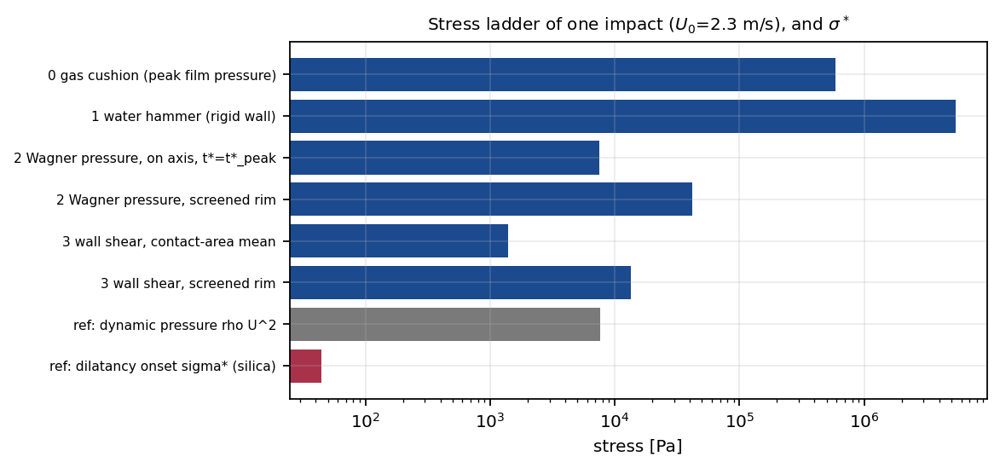
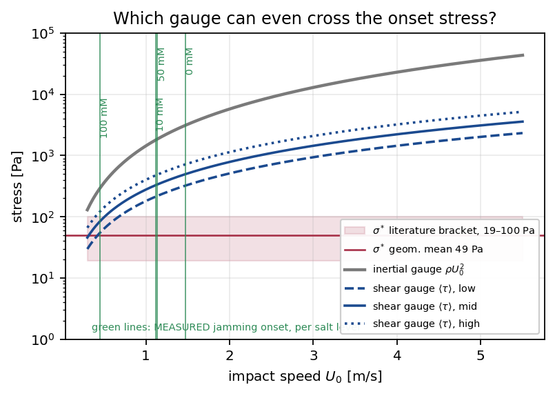
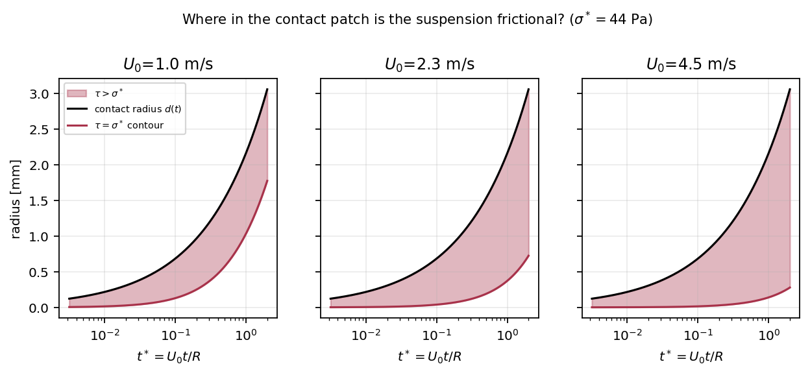

# Stress in an impacting drop, and the inertial–dilatant number for 800 nm silica

**Prepared for the Driscoll group, 6 August 2026.**
Every number regenerates from `results.py`; every equation is checked in `test_impact_stress.py`
(53 tests). The analysis went through two adversarial referee passes and a numerical-code audit, and a
fair amount of it changed as a result. What changed, and why, is in Appendix D.
Working directory: `C:\Users\compl\Desktop\Projects\impact_stress\`

---

## 0. The short version

Your PI asked two things.

**(1) Stress localization and stress values in an impacting drop.** There is a complete closed-form
answer in the literature, and one of its two key papers carries a figure taken in your own lab. The
wall pressure is

$$p(r,t) \;=\; \frac{3}{\pi}\,\frac{\rho U_0^2 R}{\sqrt{d(t)^2 - r^2}}, \qquad d(t)=\sqrt{3RU_0 t}$$

a self-similar field whose maximum sits **in a ring at the moving contact line, not at the impact
point**. The wall shear stress has the same structure with a stronger, 1/(distance to the rim)
divergence, and is smaller than the pressure by roughly $\mathrm{Re}^{-1/2}$. For your drops that is
about a factor of 5.

**(2) The inertial–dilatant number.** The term exists, it is one paper old, and **Michelle is a
co-author**: Mobaseri, Gordillo, Burton, Yoon, Lee, Kumar, Driscoll & Cheng, *Phys. Rev. Lett.* **136**,
148201 (2026). They define

$$\mathrm{ID} \equiv \frac{F_i}{F_d} = \frac{\rho\,\kappa\,U_0}{A\,\mu_w\,\Delta\phi\,D_0}$$

For your 800 nm silica, $\mathrm{ID}\approx6\times10^{-5}$, roughly **220× smaller than for the
cornstarch the number was built on**, because $\mathrm{ID}\propto\kappa\propto a^2$ and your particles
are 12.5× smaller. Colloidal silica sits far into the dilatant corner, and the re-entrant liquid regime
that is the paper's headline is unreachable on a bench tower.

**Four things worth your attention, in order of how much they matter to the group:**

- **$\rho U_0^2$ cannot measure an onset; the wall shear stress can, but only just.** $\rho U_0^2$ runs
  40–800× above $\sigma^\ast$ across your whole velocity range, so it has no reachable threshold. The
  wall shear stress is 5–10× smaller and does cross $\sigma^\ast$ near the bottom of your window. It is
  not a quantitative predictor: at your own calibrated parameters it puts the onset at 0.23–0.41 m/s
  against a measured 0.455–1.473 m/s, i.e. **systematically 1.1–6× low**. What it gives you free of every
  fitted constant is the *scaling* $U_c\propto\sigma^{\ast2/3}$, and therefore four falsifiable
  $\sigma^\ast$ ratios (§5).
- **A drop hitting a bath of its own liquid feels no wall shear at all.** The interface becomes a
  symmetry plane. Pressure halves; shear goes to zero. If shear is what drives thickening, a suspension
  drop on a matched bath should not thicken at the contact, a sharp, cheap test your bath rig can
  already run (§4).
- **Equation 6 of the ID paper does not evaluate to 1 at the boundary it is drawn at.** ID depends on
  $U_0$ and $D_0$ only through $U_0/D_0$, which is the abscissa of their own Fig. 1(d), so the ID = 1
  contour is determinate in the plotted plane, and Eq. 6 as printed puts it at
  $U_0/D_0\approx2\times10^5$ s$^{-1}$ while the experiment spans 125–1800 s$^{-1}$. Two decades off the right edge
  of the figure. The shape is right, so it is a constant prefactor of ~150 living somewhere not on arXiv.
  **One email to a co-author settles it** (§7).
- **Your fitted $\dot\gamma_c$ is convention-bound by a factor of 4.5.** The $U_0/D_0$ convention your
  front collapse uses is the one Cheng's group refuted in PNAS last year. That does not make your number
  wrong; it makes it a number that must be quoted with its convention attached (§8).

---

## 1. Orientation: an impact is four events, not one

Your drop: 800 nm silica at $\phi = 0.44$ in water, $D_0 = 2.5$ mm, $U_0 = 2.3$ m/s (band B), on glass.

| quantity | symbol | value |
|---|---|---|
| suspension density | $\rho = \phi\rho_p + (1-\phi)\rho_f$ | 1440 kg/m³ |
| low-stress viscosity | $\eta_0$ | 34 mPa·s (bracket 7–34, §10) |
| sound speed (Wood's law) | $c$ | 1629 m/s |
| Reynolds number | $\rho U_0 D_0/\eta_0$ | 241 |
| Weber number | $\rho U_0^2 D_0/\gamma$ | 265 |
| Ohnesorge | $\eta/\sqrt{\rho\gamma D_0}$ | 0.067 |
| Mach number | $U_0/c$ | $1.4\times10^{-3}$ |
| gas Stokes number | $\eta_{\rm air}/(\rho U_0 D_0)$ | $2.2\times10^{-6}$ |
| inertial time | $R/U_0$ | 544 µs |
| impact time | $D_0/U_0$ | 1087 µs |

### Stage 0: the air cushion, before contact
The drop never touches the glass cleanly. Air cannot escape the closing gap fast enough and lifts the
underside into a dimple: film thickness $\sim R\,\mathrm{St}^{2/3}\approx$ **340 nm**, radius
$\sim R\,\mathrm{St}^{1/3}\approx$ **20 µm**, gas pressure $\sim\rho U_0^2\mathrm{St}^{-1/3}\approx$
**0.6 MPa**. These are scalings with order-unity prefactors omitted, so do not quote them to better than
one figure. The consequence that matters is structural: **the gas film screens the water hammer** and
delays true contact.

### Stage 1: the water hammer, nanoseconds
At first touch the liquid cannot get out of the way and is compressed. One-dimensional acoustics gives
$p = \rho c U_0 =$ **5.4 MPa**, 700× the dynamic pressure and the largest number in the problem. It is
also nearly irrelevant:

- it lasts $t_d = RU_0/2c^2 =$ **0.54 ns**
- over a contact patch of radius $RU_0/c =$ **1.8 µm**
- touching a fraction of order $10^{-9}$ of the drop's volume (the exact figure depends on whether you
  take the compressed region as a cylinder or a spherical cap; it lies between $10^{-12}$ and $10^{-9}$,
  and is negligible either way).

Worth saying out loud in a talk: *the biggest stress in a drop impact is a billion times too small to
matter, and the air film screens most of what is left.*

### Stage 2: Wagner, the one that matters
Once the shock detaches the liquid is effectively incompressible and the flow is set by an expanding
wetted disc. Force, pressure field and stress localization all live here. Derived in §2.

### Stage 3: the lamella
The drop is now a spreading sheet. Pressure has collapsed; what survives is **viscous shear at the
wall**. This is the stage that matters for a shear-thickening drop, and it is §5.

---

## 2. The pressure field, from scratch

Four lines, reproducible on a whiteboard.

**Step 1. How big is the contact patch?** A sphere of radius $R$ descending at $U_0$ intersects the
plane in a circle of radius $\sqrt{2RU_0t}$, but the free surface piles up ahead of that intersection,
so the *wetted* radius is larger. Wagner's condition fixes the correction:

$$\boxed{\;d(t) = \sqrt{3\,R\,U_0\,t}\;}$$

Cheng, Sun & Gordillo write it as $r_0=\sqrt{6DVt}/2$; with $D=2R$ that is the same equation. Confirmed
experimentally by Riboux & Gordillo and by Gordillo, Sun & Cheng.

**Step 2. Replace the drop by a disc.** Near the wall the flow is that of a flat disc of radius $d(t)$
pushed into a half-space at speed $U_0$. The potential on such a disc is classical:

$$\Phi(r,t) = -\frac{2}{\pi}U_0\sqrt{d(t)^2-r^2}$$

**Step 3. Unsteady Bernoulli.** In an impact the pressure comes from the *acceleration* term, not the
kinetic one:

$$p = -\rho\frac{\partial\Phi}{\partial t} = \frac{2}{\pi}\rho U_0\,\frac{d\,\dot d}{\sqrt{d^2-r^2}}$$

**Step 4. The trick.** Because $d^2 = 3RU_0t$ is linear in $t$, the product $d\dot d$ is a *constant*:

$$d\dot d = \tfrac12\frac{\mathrm d(d^2)}{\mathrm dt} = \tfrac32 RU_0$$

Substituting,

$$\boxed{\;p(r,t) = \frac{3}{\pi}\frac{\rho U_0^2R}{\sqrt{d^2-r^2}}
= \underbrace{\frac{\sqrt3}{\pi}\rho U_0^2}_{\text{scale}}\;
\underbrace{t^{*-1/2}}_{\text{amplitude}}\;
\underbrace{(1-\xi^2)^{-1/2}}_{\text{shape}}\;}$$

with $t^*=U_0t/R$ and $\xi=r/d(t)$.

**This is exactly Eq. [10] of Cheng, Sun & Gordillo (2022), prefactor included.** The test suite checks
the identity symbolically, and Philippi, Lagrée & Antkowiak (2016) reach the same closed form
$P(\xi,0)=3/(\pi\sqrt{3-\xi^2})$ from the full self-similar solution. As a further check, integrating
this field over the wetted disc reproduces the published impact force $\tilde F=(3\sqrt6/2)\tilde t^{1/2}$
to three figures, tying Eq. [10] and Eq. [1] together with no shared algebra.

### How to read it

- $\rho U_0^2$ sets the stress scale.
- $t^{*-1/2}$ is the amplitude. **The earlier you look, the larger it is.** It equals $\rho U_0^2$ at
  $t^*=3/\pi^2=0.30$, about a third of the way through the impact.
- $(1-\xi^2)^{-1/2}$ is the shape, and **the shape is the stress localization**: flat across the middle
  of the contact patch, divergent at its rim.

So the maximum is **off-axis**, in an annulus racing outward with the contact line. That is the
counter-intuitive part and it deserves a slide. A steady jet on a wall has its maximum at the stagnation
point, because for steady flow $\partial\Phi/\partial t = 0$ and only the negative kinetic term survives.
An impact is the opposite: the acceleration term dominates and is largest where the contact line sweeps
fastest.

The ring is not a theoretical curiosity. It has been seen three ways: as ring cracks in zinc sulphide
from 340 m/s impacts; as an off-axis peak on piezo sensors under a 2D drop; and directly, by Cheng's
group, imaging the deformation of an elastic gel under an impacting drop (Sun *et al.*, *Nat. Commun.*
**13**, 1703, 2022).

One caveat on the absolute value: Eq. [10] drops a constant $\tfrac12\rho U_0^2$ that Eq. [9] carries.
The paper calls it an absorbable choice of reference pressure, which is fine for the shape and for
anything deviatoric, but it is 29% of the on-axis total at $t^*=0.1$ and 50% of the singular part at
$t^*=0.3$. If you quote a gauge pressure late in the impact, put it back.


### Where the compressible stage plugs back in

Setting the on-axis Wagner pressure equal to the water-hammer pressure:

$$\frac{\sqrt3}{\pi}\rho U_0^2\,t^{*-1/2} = \rho c U_0 \;\;\Longrightarrow\;\; t^*_\times = \frac{3}{\pi^2}\mathrm{Ma}^2$$

Independently, the geometric shock-detachment argument gives $t^*_d=\mathrm{Ma}^2/2$. Two arguments
sharing no algebra, agreeing to a factor 1.6. So the compressible stage is not a separate phenomenon
bolted onto $t=0$. **It is what makes the incompressible solution finite.**

---

## 3. Stress localization, quantified

At $U_0=2.3$ m/s, evaluated at the peak-force time.

| stage | stress | ÷ $\rho U_0^2$ | localized over | lasts |
|---|---:|---:|---:|---:|
| gas cushion | ~0.6 MPa | ~77 | 20 µm | 0.15 µs |
| water hammer (rigid) | 5.4 MPa | 708 | 1.8 µm | 0.0005 µs |
| Wagner pressure, on axis | 7.5 kPa | 0.98 | 1.2 mm | 171 µs |
| **Wagner pressure, at the rim** | **42 kPa** | **5.5** | **20 µm** | 171 µs |
| wall shear, area-averaged | 1.4 kPa | 0.18 | 1.2 mm | 171 µs |
| wall shear, at the rim | 13 kPa | 1.8 | 20 µm | 171 µs |
| — reference: $\rho U_0^2$ | 7.6 kPa | 1 | — | — |
| — reference: $\sigma^\ast$ (silica) | **44 Pa** | 0.006 | 0.8 µm | — |

Peak force $F_{\max}=0.92\,\rho D_0^2U_0^2=$ **44 mN** at $t=171$ µs, measurable with a piezo sensor.
(The 0.92 rather than the high-Re 0.85 is the finite-Reynolds correction: a viscous drop hits *harder*,
because the boundary layer speeds up the propagation of the self-similar pressure field.)



**How firm is the rim amplification?** Less firm than a single number suggests, and this is the largest
soft spot in the rigid-substrate half of the analysis. The 5.5 comes from cutting the singularity off at
the screening length Philippi *et al.* measured, $\Delta=0.02\sqrt{VDt}$, which is 1.6% of the contact
radius. Three problems with quoting it:

1. It is time-independent *only* because $\Delta\propto\sqrt t$. That proportionality is an empirical
   fit. Philippi *et al.* say plainly that the origin of $\Delta$ "needs to be clearly identified".
2. Their two candidate mechanisms disagree qualitatively, a viscous length gives an amplification that
   grows with time and depends on Re; an inertial Wagner inner layer gives one that is unbounded as
   $t\to0$, and **both are excluded by their own Table 2**, which shows $\Delta$ varying by less than 2×
   across Re 250–5000.
3. Inside their own quoted $\Delta$ range the ratio is 3.8–5.4, and below $t^*\sim2\times10^{-5}$ the rim
   is capped by compressibility anyway.

**Quote 4–6, over $5\times10^{-3}\lesssim t^*\lesssim0.1$, and say the mechanism is unknown.** The
area-averaged shear stress is the number to lean on instead, but it is not immune either: that integral
is logarithmically divergent, so it depends on $\Delta$ too, just weakly. The published prefactor (1.14)
sits at the top of a defensible band 0.76–1.14, which is +8% to +31% on every onset velocity downstream.

---

## 4. What changes on a fluid or soft substrate

Your bath work and the Carbopol ladder live here. There are three laws, and the mistake to avoid is
applying the wrong one.

### (a) Compressible stage: acoustic impedance sharing
$$p = U_0\,\frac{Z_1Z_2}{Z_1+Z_2}\qquad\Longrightarrow\qquad \frac{p}{p_{\rm rigid}}=\frac{Z_2}{Z_1+Z_2}$$

A rigid target recovers $\rho cU_0$; a bath of the same liquid gives **exactly one half**. This is de
Haller's 1933 result, still used in the droplet-erosion literature. Note that a real glass slide is
**not** acoustically rigid: fused silica has $Z=1.3\times10^7$ against your suspension's
$2.3\times10^6$, so the slide takes **15% off** the water-hammer pressure.

### (b) Incompressible (Wagner) stage: inertia sharing
Redo the Wagner derivation with a target that moves. The matching condition is continuity of *pressure
impulse* $\rho\Phi$, and both sides solve the same flat-disc problem and therefore carry the same
universal $2/\pi$. That gives $\rho_1u_1=\rho_2u_2$ with $u_1+u_2=U_0$, hence

$$\frac{p}{p_{\rm rigid}} = \frac{\rho_2}{\rho_1+\rho_2}$$

**The same law with $Z\to\rho$.** Two media sharing an interface share the load in proportion to their
inertia: acoustic impedance when waves matter, mass density when they do not. Matched liquids give one
half again.

Two things I had wrong in the first draft. First, **the factor 3 in $d^2=3RU_0t$ does not change** on a
deformable target: each side's free surface responds with the same shape function at the same $d$, so
the Wagner condition involves only the relative approach. Cimpeanu & Moore (*JFM* **856**, 764, 2018)
Eq. (3.17) confirm it, a drop on a rigid wall and a drop on a deep pool have an identical $d(t)$. For a
*curved* target it becomes a reduced radius, $1/R_{\rm eff}=1/R_1+1/R_2$. Second, their Eq. (3.13) gives
the interface coefficient $(1+V)/2$, equal to 1 at a rigid wall and 1/2 at a deep pool: a **published
confirmation** of the factor 1/2 at matched density. The generalisation to $\rho_1\ne\rho_2$ is derived
here and is not published there.

**Do not conflate this with $V_e=V/2$.** Langley *et al.* and Bisighini *et al.* report the interface
receding at $V/2$, which is the same $u_1$, but substituting $V\to V/2$ into the Wagner pressure would
give $2^{-3/2}=0.354$, or 0.25 on a $\rho V^2$ gauge. The answer is 1/2 because $d(t)$ is set by the
*relative* approach while the amplitude is set by $u_1$, so only one velocity factor is halved. This is
the single most likely referee misreading.

### (b') And the shear stress does something else entirely
This was missing from the first draft and it is the most consequential omission. Wall shear comes from
**slip** between liquid and surface. On a liquid target both sides move tangentially, and the slip
driving the Stokes layer is their difference:

$$\frac{|u_1-u_2|}{U_0} = \frac{|\rho_2-\rho_1|}{\rho_1+\rho_2}$$

$$\boxed{\;\text{a drop impacting a deep bath of ITSELF feels no wall shear at all.}\;}$$

At matched density the interface is a symmetry plane with a slip boundary condition, Cheng, Sun &
Gordillo's own Fig. 7a caption says exactly that. **The pressure halves; the shear vanishes.** For a
water bath under a $\phi=0.44$ suspension drop the density mismatch leaves only 18% of the rigid-wall
slip.

### (c) An elastic solid: a deflection criterion
The target deflects by $w\sim pd/E^\ast$, which matters once $w$ is comparable to the gap being closed.
Working it through, the deflection turns out to be time-independent while the gap grows linearly in
$t^*$, so

$$t^\ast \lesssim \frac{2}{\pi}\,\mathcal{C}, \qquad \mathcal{C}=\frac{\rho U_0^2}{E^\ast}\ \ \text{(the Cauchy number)}$$

The $2/\pi$ is real and must not be dropped. **Howland's splashing criterion is this one:** their
$p_{\rm peak}\gtrsim E$ with $p_{\rm peak}=\rho RU/(t_{\rm ej}-t_i)$ is algebraically
$\mathcal{C}\gtrsim t^*_{\rm ej}$, and their worked example reproduces their quoted $E_c = 93$ kPa
exactly. But $\mathcal{C}$ is **necessary, not sufficient**: Yokoyama *et al.* (*Nat. Commun.* **17**,
607, 2026) show the peak force does not collapse on it alone, the inertial-to-Hertzian crossover needs
a second group built from the *drop's* viscosity, and they classify the problem as self-similarity of
the second kind.

### (d) A yield-stress bath: $J$ is the switch between (b) and (c)
Your Carbopol arm is already indexed on $J=\tau_y/\rho U_0^2$. In this framework $J$ is not a stiffness.
It is **the switch that decides which law applies**: $J\ll1$, the bath yields everywhere the impact
touches and behaves as a liquid, use (b); $J\gtrsim1$, it never yields and behaves as an elastic solid,
use (c).

### Numbers for your targets, $U_0=2.3$ m/s

| target | pressure, acoustic | pressure, inertial | **shear (slip)** | $\mathcal{C}$ | $J$ |
|---|---:|---:|---:|---:|---:|
| rigid (idealisation) | 1.00 | 1.00 | 1.00 | 0 | — |
| fused-silica slide (real) | **0.85** | 1.00 | 1.00 | $1\times10^{-7}$ | — |
| deep water bath | 0.39 | 0.41 | **0.18** | — | — |
| deep bath of the same suspension | 0.50 | 0.50 | **0.00** | — | — |
| Carbopol, $\tau_y=1$ Pa | 0.39 | 0.41 | 0.18 | — | $1.3\times10^{-4}$ |
| Carbopol, $\tau_y=30$ Pa | 0.39 | 0.41 | 0.18 | — | $3.9\times10^{-3}$ |
| PDMS gel, $E=100$ kPa | 0.38 | n/a | 0.20 | **0.057** | — |
| acrylic, $E=3$ GPa | 0.43 | n/a | 0.10 | $1.9\times10^{-6}$ | — |

The "n/a" is deliberate: the inertia-sharing law is derived for a target that *flows*, so reporting it
for a solid would be a silent 2.5× error. The code returns NaN there with a stated reason.

**Both your Carbopol concentrations sit at $J\lesssim4\times10^{-3}$**, deep in the liquid-like corner:
the bath yields under the impact throughout the planned ladder. Reaching $J\sim1$ needs
$\tau_y\sim\rho U_0^2\approx$ 7.6 kPa, which no Carbopol concentration in your design comes near. Worth
knowing before the 20-run grid rather than after.

**One caution the literature is loud about.** Compliance changes the *magnitude* of the stress but, in
three independent measurements, not the *localization length*: Howland finds $d=\sqrt{3RUt}$ independent
of $E$; Sun *et al.* find the turning point and the shear maximum independent of $E$ and of wettability;
Langley finds no clear stiffness dependence below a critical value. "A softer substrate spreads the load
out" is not what happens. The load gets smaller and the ejecta slow down.

---

## 5. The suspension question: which stress does dilatancy see?

### The threshold
A dense suspension thickens when the local stress exceeds an onset stress $\sigma^\ast$ at which the
repulsion holding particles apart is overcome and contacts turn frictional. Four independent estimates
for your material:

| source | $\sigma^\ast$ (Pa) |
|---|---:|
| Ishibashi (2026), fitted law with a measured $F^\ast = 0.3$ nN | 19 |
| Lin *et al.*, *PRL* **115**, 228304 (2015), scaled by $a^{-2}$ | 63 |
| Shah, Arora & Driscoll (2022), **your own 830 nm particles** | ~100 |
| your repo's flow-curve fit, `params_fitted.yaml` | 44 |

Geometric mean of the three external ones: **49 Pa**. The repo's 44 Pa sits inside their range, which is
the main reason to trust it as an order-of-magnitude anchor despite the fit having failed its own gate.

A subtlety that matters for how you talk about it: **Wyart & Cates write their model in particle
pressure**, not shear stress, their $P^\ast\sim F^\ast/R^2$, their control parameter is $p=P/P^\ast$,
and their Fig. 1 caption says "onset pressure $p\simeq1$". A steady flow-curve fit cannot tell the two
apart, since $\sigma/P=\mu\sim O(1)$ in simple shear. So your fitted 44 Pa is really $\mu P^\ast$, and
$P^\ast$ is 44–150 Pa. Do not assert that $\sigma^\ast$ "is a shear stress" in front of a referee who
knows the paper.

### Why $\rho U_0^2$ fails
Over your accessible velocities $\rho U_0^2=$ 1.9–36 kPa against $\sigma^\ast\approx$ 20–100 Pa, so
$\Lambda_P=\rho U_0^2/\sigma^\ast$ runs 43 to 814. **Every drop of every suspension is far above
threshold at the slowest speed anyone can drop from.** A gauge with no reachable threshold cannot measure
one. Your project reached this conclusion independently and retired the gauge; this supplies the
replacement and the reason.

### The right reason to use the shear stress
Not the one in my first draft. The defensible argument is about **total versus effective stress**.
$\rho U_0^2$ is a *total* stress applied to a saturated two-phase medium far faster than the pore
pressure can equilibrate. Under undrained loading the pore fluid carries essentially all of an isotropic
increment, so the *effective* particle pressure, the quantity that actually sets $p=P/P^\ast$, barely
moves. What does generate effective particle pressure is shear, through Reynolds dilatancy: the packing
must expand to shear, the expansion is resisted by Darcy backflow, and the resulting suction presses the
particles together. So the shear stress is a **proxy for a pressure criterion, not a rival to one**,
and that is what makes it consistent with the ID framework in §6 rather than in competition with it.

Philippi *et al.* solved for that shear stress; Cheng, Sun & Gordillo print it as Eq. [13]:

$$\tau(r,t) = \frac{2}{\pi^{3/2}}\,\rho U_0^2\,\mathrm{Re}_R^{-1/2}\,t^{*-1/2}\,\frac{\xi}{1-\xi^2},
\qquad \mathrm{Re}_R=\frac{\rho U_0R}{\eta}$$

Three features carry the argument:

1. **Prefactor $\rho U_0^2\mathrm{Re}_R^{-1/2}$.** At your $\mathrm{Re}_R\approx121$ the area-averaged
   shear stress is 5.3× below the on-axis pressure and 5–10× below $\rho U_0^2$ depending on when you
   evaluate it. (An earlier draft said 100×; that was wrong by an order of magnitude.)
2. **Shape $\xi/(1-\xi^2)$**, a 1/(distance to rim) divergence, sharper than the pressure's inverse
   square root, and **exactly zero on the axis** by symmetry. The shear maximum stays at the drop's edge
   for the whole impact while the pressure maximum migrates to the centre. Sun *et al.* found this same
   form collapsed their gel measurements best.
3. **$\tau\propto\sqrt\eta$, not $\eta$.** A factor-5 uncertainty in your drop's viscosity is only 2.2×
   in the stress, which is what makes the gauge usable despite $\eta_0$ being unresolved.

For a single robust number, integrate. Philippi's own drag force divided by the contact area gives

$$\langle\tau\rangle = C\,\rho U_0^2\,\mathrm{Re}_R^{-1/2}\,t^{*-1/2}
= C\,t^{*-1/2}\sqrt{\frac{\rho\,\eta\,U_0^3}{R}}, \qquad C = 1.14\ (\text{band }0.76\text{–}1.14)$$

and the proposed group is its ratio to the threshold:

$$\boxed{\;\Lambda_F = \frac{\langle\tau\rangle}{\sigma^\ast}\;}$$

### Does it work? Partly, and here is the honest accounting

Evaluated at $t^*=0.315$, the peak-force time (see §10 for why not $t^*=1$):

| $U_0$ (m/s) | $\rho U_0^2$ (Pa) | $\Lambda_P$ | $\langle\tau\rangle$ (Pa) | $\Lambda_F$ | frictional area fraction |
|---:|---:|---:|---:|---:|---:|
| 1.15 | 1904 | 43 | 496 | 11.2 | 0.93 |
| 2.3 | 7618 | 172 | 1403 | 31.7 | 0.99 |
| 5.0 | 36000 | 814 | 4498 | 102 | 1.00 |

Setting $\Lambda_F=1$ gives an onset velocity

$$U_c = \left[\frac{\sigma^{\ast2}R\,t^*}{C^2\rho\eta}\right]^{1/3} \;\propto\; \sigma^{\ast\,2/3}$$

**At the internally self-consistent parameter set** (the repo's own $\sigma^\ast=44$ Pa *and* the repo's
own $\eta_0=34$ mPa·s, which came from the same fit), $U_c=0.23$ m/s on the mean criterion and 0.41 m/s
on the half-area criterion. Your measured onsets are **1.473 / 1.120 / 1.138 / 0.455 m/s**. So the
framework is **systematically low, by 1.1× at 100 mM and by up to 6× at 0 mM.**

Across the full parameter freedom ($\sigma^\ast$ 19–100 Pa, $\eta_0$ 7–34 mPa·s, criterion, and $t^*$)
$U_c$ spans roughly 0.09–2.5 m/s. That range contains the data, but a 28× bracket containing a 3× spread
is not a test, it would contain almost any bench measurement. Reaching 1.47 m/s requires
$\sigma^\ast=100$ Pa *and* the water-like viscosity *and* the loosest criterion, all three at their
extreme simultaneously.

**So state it this way, and no stronger:** the shear gauge is the only one of the two that produces a
threshold anywhere near the observed window; it lands the right order of magnitude with no fitted
constants; it is systematically low by a factor of a few; and it is not a quantitative prediction.



### The direction that is actually useful: invert it
The *scaling* $U_c\propto\sigma^{\ast2/3}$ carries no fitted constant, so ratios between salt levels are
free of every uncertainty above, viscosity, drop size, criterion, evaluation time and prefactor all
cancel:

$$\frac{\sigma^\ast(\text{salt})}{\sigma^\ast(0\ \mathrm{mM})} = \left[\frac{u_0^\ast(\text{salt})}{u_0^\ast(0\ \mathrm{mM})}\right]^{3/2}$$

| salt | $u_0^\ast$ measured (m/s) | **predicted $\sigma^\ast/\sigma^\ast_{0\rm mM}$** |
|---|---:|---:|
| 0 mM | 1.473 | 1.00 |
| 10 mM | 1.120 | **0.66** |
| 50 mM | 1.138 | **0.68** |
| 100 mM | 0.455 | **0.17** |

**These four ratios are the falsifiable output of this whole analysis.** They need no rheometer
calibration, no absolute stress, and no assumption about your $\phi$ axis. Measure $\sigma^\ast$ at the
four salt levels and check them. Two features stand out and are testable: 10 mM and 50 mM are predicted
indistinguishable (0.66 vs 0.68), and the drop to 100 mM is a factor of four.

Three caveats a referee will raise, so raise them first:

- **The shape is wrong for a screening curve.** $\mathrm{d}\ln u_0^\ast/\mathrm{d}\ln I$ is $+0.01$ from
  10 to 50 mM and $-1.32$ from 50 to 100 mM. Constant-charge DLVO with $U_c\propto\sigma^{\ast2/3}$
  predicts a single exponent everywhere. A flat stretch followed by a cliff looks like a *threshold*:
  approach to a critical coagulation concentration, not continuous barrier reduction.
- **DLVO cannot pin the number.** At constant surface *potential* the ratio comes out 0.04 (salt would
  *raise* $\sigma^\ast$, wrong sign); at constant surface *charge*, 24×. The measured 5.8 sits inside that
  range, so everything is carried by an unmeasured $\zeta(I)$. Matching 5.8 needs $\zeta$ falling from
  about $-60$ to $-21$ mV, at the very edge of published Stöber-silica values, and Li$^+$, being the least
  surface-binding alkali cation, should depress $|\zeta|$ *less* than Na$^+$ would.
- **The electroviscous correction makes it larger.** At the true "0 mM" ionic strength the double layer
  swells the particles enough to raise $\eta_0$ about 2×. Since $\sigma^\ast\propto U_c^{3/2}\eta^{1/2}$,
  the same measured velocities then imply a ratio of **8.4× rather than 5.8×**. Quote both.

One more correction worth carrying: the ionic strength of your nominal "0 mM" sample is **not**
$2.5\times10^{-6}$ M. That is CO$_2$-equilibrated pure water; at $\phi=0.44$ the counterions released by the
particles themselves dominate, giving $I\approx10^{-4}$ M and $\kappa^{-1}\approx23$ nm rather than
190 nm. The screening ratio from 0 to 100 mM is about 24×, not 200×.

### Where in the drop is it frictional?
Because the shear field is known everywhere, you can locate the $\tau=\sigma^\ast$ contour. Solving
$\xi/(1-\xi^2)=K$ gives $\xi_c$, and material at $\xi>\xi_c$ is above onset. **So the thickened region is
an annulus hugging the rim, not a disc at the centre** (Figure 4), filling inward as the impact proceeds.
That is a qualitative prediction your under-view footage can check directly, and it is a strong test: if
the footage shows a central disc, the deviatoric gauge is wrong in its spatial structure regardless of
its magnitude. Shah, Arora & Driscoll say in words that the solidification front must be where "the
stress falls below the critical stress"; this turns that sentence into a calculable curve.



---

## 6. The inertial–dilatant number

### What it is
From Mobaseri *et al.*, *PRL* **136**, 148201 (2026), Eq. 6. Two competing forces:

- **Inertial** (Wagner / Gordillo–Sun–Cheng): $F_i\sim\rho U_0^2D_0^2$
- **Dilatant** (Reynolds–Darcy, after Jérôme, Vandenberghe & Forterre): the suspension must expand to
  shear, expansion sucks solvent inward through the pores, and Darcy resistance to that flow generates a
  pore suction that presses the particles together. $F_d\sim A\mu_wU_0D_0^3\Delta\phi/\kappa$

$$\mathrm{ID}\equiv\frac{F_i}{F_d}=\frac{\rho\kappa U_0}{A\mu_w\Delta\phi D_0}=\frac{t_d}{t_i}$$

with $\kappa=(1-\phi)^3a^2/180\phi^2$ (Carman–Kozeny, $a$ = particle **diameter**),
$\Delta\phi=\phi-\phi_c$, $\mu_w=1$ mPa·s, and $A$ a granular bearing-capacity coefficient
($\beta_0=44\pm2°$, cornstarch's repose angle). $\mathrm{ID}\ll1$ means dilatancy wins and the impact is
solid-like; $\mathrm{ID}\gg1$ means inertia wins and you get their re-entrant liquid regime.

### What it gives for your silica
The one unmeasured input is $\phi_c$, so here it is as a function of $\phi_c$, at $U_0=2.3$ m/s,
$D_0=2.5$ mm, $\phi=0.44$, $a=800$ nm:

| $\phi_c$ | $\Delta\phi$ | $\kappa$ (m²) | **ID** | $t_d$ | Darcy $P_f$ (Pa) |
|---:|---:|---:|---:|---:|---:|
| 0.36 | 0.08 | $3.2\times10^{-15}$ | $1.2\times10^{-5}$ | 13 ns | $1.4\times10^{8}$ |
| 0.40 | 0.04 | $3.2\times10^{-15}$ | $2.7\times10^{-5}$ | 29 ns | $7.1\times10^{7}$ |
| 0.42 | 0.02 | $3.2\times10^{-15}$ | $5.5\times10^{-5}$ | 60 ns | $3.6\times10^{7}$ |
| 0.43 | 0.01 | $3.2\times10^{-15}$ | $1.1\times10^{-4}$ | 122 ns | $1.8\times10^{7}$ |
| 0.47 (Shah's value) | **−0.03** | — | **no dilatant branch at all** | — | 0 |

**Headline: ID $\approx6\times10^{-5}$, about 220× smaller than cornstarch at matched conditions.** The
whole difference is $\kappa\propto a^2$: your particles are 12.5× smaller, so $\kappa$ is 156× smaller,
so Darcy resistance to dilation is 156× larger. Colloidal silica is *more* dilatant, not less.

Two consequences for the group:

- **Regime 3 is unreachable for you.** ID $=1$ would need $U_0\sim2\times10^5$ m/s on the literal
  formula. Whatever you see at high speed is not the re-entrant liquid the paper describes.
- **The last row is a real problem, and an informative one.** If $\phi_c\approx0.47$, what Shah, Arora &
  Driscoll measured on these same 830 nm particles, then at $\phi=0.44$ your suspension is *below* the
  dilatancy onset, $\Delta\phi<0$, and there is no dilatant branch for inertia to compete with. But your
  drops arrest and grow solidification fronts at $\phi=0.42$–0.45. So either your $\phi$ axis is offset
  from Shah's, or $\phi_c$ for your particles is below 0.42. **ID is undefined for your system until
  $\phi_c$ is measured**, and running it backwards from the existence of fronts at 0.42 says
  $\phi_c\lesssim0.42$. That is a number the project does not have and can get.

### The same tension shows up in Wyart–Cates, and adjusting $\phi_M$ will not fix it
The fitted $\phi_M=0.5176$ means that at $\phi=0.44$ the model cannot shear-jam at any stress. The repo's
own closure class refuses to instantiate at the paper's operating point for exactly this reason, which is
pinned as a test. The full dynamic range available at $\phi=0.44$ is $\eta_0=34\to211$ mPa·s, a 6×
thickening, and even fully thickened $\mathrm{Re}\approx39$, still inertial. There is no arrest
available at any stress.

Three possible resolutions, not equally good:

- **Adjusting $\phi_M$ down does not work.** Wyart & Cates' own values are $\phi_m\approx0.58$ and
  $\phi_0\approx0.64$; the repo's fit is displaced from both in *opposite* directions with $\phi_0$
  pinned at its optimizer cap, the signature of a degenerate two-parameter fit. Every literature
  correction moves $\phi_M$ *up*, making the mismatch worse.
- **A $\phi$-axis offset would work but needs a large error:** $+0.078$ absolute, +17.6% relative. The
  most likely single cause is the particle density used to convert mass to volume fraction, the repo
  assumes $\rho_p=2.0$ g/cm³ for porous Stöber silica, and $\rho_p=1.70$ would do it. Your own files
  already carry an unresolved 1.9–2.6 g/cm³ spread on this number.
- **Frustrated dilatancy against the free surface** (Brown & Jaeger's mechanism), or confinement, is
  required *in any case*, because steady-state Wyart–Cates is a local constitutive law with **no front
  solution at any $\phi$**, and a propagating solidification front is exactly what you measure.

**The discriminating measurement is cheap.** Vary surface tension at fixed $\phi$ and salt (a nonionic
surfactant takes $\gamma$ from 72 to 30 mN/m) and re-measure $u_0^\ast$. If the arrest threshold moves
with $\gamma$, the free surface is load-bearing and the mechanism is frustrated dilatancy. If it does
not, the mechanism is bulk and the $\phi$ axis is the problem. One afternoon, and it separates the two
branches in a way the $\phi$-axis measurement alone cannot.


### Sensitivities
$\beta_0$ enters exponentially and is unmeasured for silica: ID varies 3× over $\beta_0=30$–51°.
$\phi_c$ contributes 9× over the plausible range. Neither is fatal for the *ratio* between systems,
which is what the headline uses.

---

## 7. Two problems with Eq. 6, and what does and does not fix them

### Problem 1: it does not evaluate to 1 at the boundary it is drawn at
With the paper's own constants at the paper's own Regime-2/3 conditions (cornstarch, $\phi=0.41$,
$U_0=5.1$ m/s, $D_0=4$ mm, $a=10$ µm, $\phi_c=0.37$, $\beta_0=44°$): $\kappa=6.79\times10^{-13}$ m²,
$\rho=1226$, $A=4.01$, $\Delta\phi=0.04$, giving $\mathrm{ID}=6.6\times10^{-3}$. Computed twice,
independently, agreeing to three figures.

The sharpest form of the objection needs no figure at all. **ID depends on $U_0$ and $D_0$ only through
$U_0/D_0$, which is literally the abscissa of their Fig. 1(d).** So the ID = 1 contour is a determinate
curve in the plotted plane, and Eq. 6 as printed puts it at $U_0/D_0\approx1.9\times10^5$ s$^{-1}$ against an
experimental range of 125–1800 s$^{-1}$, two decades off the right edge of the figure. A curve is
nevertheless drawn inside the figure, and its *shape* is right (monotone in $\phi$, rising 1.9× from
$\phi=0.41$ to 0.43). So this is a **constant prefactor of ~150, not a different functional form.**

Where does it come from? Mostly from $F_d$ being written with "$\sim$" after setting $r_c\sim h\sim D_0$
and $|\mathrm dh/\mathrm dt|\sim U_0$. Carried through literally, $F_d\approx240$ N against a measured
peak force of order 0.5 N. Since $F_d\propto r_c^3$ and the real $r_c$ at the force peak is $0.49D_0$,
that substitution alone buys about 27×, short of 150 by a further 5.6×. **Their fits are unaffected**,
because Eq. 4 uses the measured $r_c(t)$ and $|\mathrm dh/\mathrm dt|$; it is only the scaling group
that is in question, and the residual most likely sits in the Supplemental Material, which is not on
arXiv.

**Concretely worth asking a co-author:** what is the numerical range of the ID axis in Fig. S8, and does
§7A compute ID from Eq. 6 or from the measured $r_c(t)$, $h(t)$? That one answer settles it.

### Problem 2: Eq. 3 predicts pore pressures that cannot exist
Look at the last column of §6's table: $10^7$–$10^8$ Pa of Darcy suction for 800 nm particles. A pore
fluid cannot do that.

**I proposed capping it at what the fluid can sustain. That fix is now largely withdrawn**, and it is
worth seeing why, because three of the four objections are things I would not have caught alone:

1. **Wrong capillary length, and it was load-bearing.** Air invasion is set by the *pore throat*,
   $r_{\rm throat}\approx0.155R_{\rm particle}$, not the particle size. Corrected, the capillary ceiling
   is 186 kPa for cornstarch and 2.3 MPa for silica, so it **never binds** and the ceiling is always
   ~1 atm for both. Then $\kappa$, $a$, $\Delta\phi$ and $D_0$ all cancel out of the capped number, and
   it can no longer distinguish 10 µm cornstarch from 800 nm silica, which was its entire purpose.
2. **The supporting evidence was misread.** Jérôme, Vandenberghe & Forterre measured $-10$ to $-100$ kPa
   in **170 µm glass beads**, where uncapped Darcy also predicts $10^4$–$10^5$ Pa. They demonstrate no
   saturation. Their closing paragraph extrapolates to cornstarch and predicts "about 1–10 MPa … in good
   agreement with impact stress estimations in cornstarch." The cited authority asserts the opposite of
   what I attributed to it.
3. **One atmosphere is not a material constant.** Degassed water sustains $-25$ to $-140$ MPa. The 1 atm
   figure is the heterogeneous-nucleation threshold of *gas-saturated* water, a sample-preparation
   property, and therefore a hypothesis you can test by degassing, not a ceiling.
4. **Capping a pressure does not cap a force**, since $r_c$ keeps growing; and once the fluid does
   cavitate the pack granulates and carries a capillary-cohesive stress instead.

### What survives: a validity criterion, not a fudge
Jérôme *et al.* state the right condition themselves. Their Darcy–Reynolds equation assumes an
incompressible pore fluid, which holds only while the pore-pressure diffusion time is short compared
with the impact:

$$\frac{\tau_d}{\tau_i} = \frac{\mu_w\,\chi\,D_0\,U_0}{\kappa} \;\propto\; a^{-2}$$

| system | $\tau_d/\tau_i$ | incompressible-Darcy valid? |
|---|---:|---|
| cornstarch, 10 µm, their conditions | **0.014** | yes, with 70× to spare |
| your silica, 800 nm | **0.81** | **no — marginal at best** |
| your silica with 0.1% entrained gas | 17.6 | no, badly |

**This is the size-dependent statement that survives**, and it is the same $a^{-2}$ sensitivity that
makes ID small for colloids, expressed as a condition on the model's validity rather than as a patch to
its output. The honest conclusion about applying ID to a submicron colloid is not "the Darcy pressure
saturates" but **"the Darcy limit itself stops applying"**. It also makes degassing a real experimental
variable for you: 0.1% entrained gas moves silica from marginal to badly invalid.

---

## 8. The shear-rate convention problem

Four conventions are in print, three from Cheng's or Michelle's groups. For your drop at 2.3 m/s:

| convention | source | value (1/s) |
|---|---|---:|
| (A) $U_0/D_0$ | Shah, Arora & Driscoll 2022 — **your fitted axis** | 920 |
| (B) $U_0/2D_0$ | same paper, for $\mathrm{Re_{eff}}$ | 460 |
| (C) $U_0/\ell$, $\ell\approx100$ µm | same paper, for $\mathrm{Re_{eff}}$ | 23 000 |
| (D) $U_0/L_c$, $L_c = 0.986\,\mathrm{Re}^{\alpha(We)}D_0$ | Mobaseri, Kumar & Cheng, *PNAS* **122**, e2500163122 (2025) | 4 160 |

(D) is the only one validated rather than asserted: it is defined by matching the *measured* viscous
dissipation integral in >1200 simulations, and the paper explicitly refutes (A), showing $L_c<0.45D_0$
always. For your conditions $L_c=0.22D_0$, so **(D) is 4.5× (A)**.

| salt | $\dot\gamma_c$ as fitted, on (A) | rescaled to (D) |
|---|---:|---:|
| 0 mM | 632 | 2860 |
| 10 mM | 479 | 2170 |
| 50 mM | 471 | 2130 |
| 100 mM | 196 | 885 |

On the rheology side, from your own calibrated Wyart–Cates parameters: $\sigma^\ast/\eta_0=1290$ s$^{-1}$, or
936 s$^{-1}$ using the self-consistent $f=0.5$ criterion.

Which is awkward, and I will not smooth it over: **as fitted on (A), your 632 s$^{-1}$ agrees with the
rheology-derived 936–1290 s$^{-1}$ to within 1.5–2×. Rescaled onto the more defensible (D), it disagrees by
2–3× in the other direction.** The correction makes the agreement worse.

Three readings, and they are distinguishable:
1. $L_c$ was calibrated for Carreau fluids on superhydrophobic surfaces. Transferring it to a jamming
   colloid on hydrophilic glass may not be legitimate.
2. $\sigma^\ast$ and $\eta_0$ come from a flow-curve fit on a $\phi$ axis offset from your drops'.
3. The two quantities are not the same object: $L_c$ is a dissipation-matched average over the whole
   impact, while your $\dot\gamma_c$ is the intercept of a front-speed fit.

The actionable part is small: **whenever the fitted $\dot\gamma_c$ is compared with anything, state the
convention.** A factor of 4.5 is larger than the salt effect you are measuring.

---

## 9. What this predicts, and how to test it

Ranked by cost.

1. **Free, from data you have.** The $\sigma^\ast$ ratios in §5: 1.00 / 0.66 / 0.68 / 0.17 (or, with the
   electroviscous correction, a 0 : 100 mM ratio of 8.4 rather than 5.8). No fitted constant.
2. **Free, from footage you have.** The frictional region should be an **annulus at the rim**, not a
   central disc, filling inward as $t^*$ grows (Figure 4). Your under-view channel can see this, and a
   central disc would falsify the deviatoric gauge outright.
3. **One afternoon, and it settles the biggest open question.** Surfactant sweep at fixed $\phi$ and
   salt, $\gamma$ 72 → 30 mN/m. If $u_0^\ast$ moves with $\gamma$, arrest is frustrated dilatancy against
   the free surface; if not, it is bulk and the $\phi$ axis is the problem (§6).
4. **One day, and it unlocks several things at once.** Thermogravimetry plus pycnometry on the *same*
   aliquots you drop and rheometer, to pin $\rho_p$ independently. Bulk jamming at $\phi=0.44$ needs
   $\rho_p=1.70$ g/cm³; your files currently span 1.9–2.6.
5. **Half a day.** $\zeta(I)$ at 0/10/50/100 mM LiCl. §5's salt inference has no content without it: the
   sign of $\mathrm d\sigma^\ast/\mathrm dI$ is set by charge regulation, and matching the observed ratio
   needs $\zeta$ falling from about $-60$ to $-21$ mV.
6. **Cheap, and it falsifies one of my own claims.** Degas the suspension and repeat. If a cavitation
   ceiling is real anywhere in this picture, degassing must move it by orders of magnitude.
7. **$\phi_c$ for your silica.** Without it, ID is undefined for your system.
8. **New capability, moderate cost.** A piezo force sensor. Predicted $F_{\max}=44$ mN at $t=171$ µs for
   a band-B drop, with the whole $F(t)$ curve predicted parameter-free. The 2026 paper found a regime
   with one that high-speed photography could not see.
9. **The bath test, and it is a clean one.** A suspension drop on a bath of its own liquid should feel
   *zero* wall shear. If the shear gauge is right it should not thicken at the contact; if it thickens
   anyway, the deviatoric gauge is not the mechanism.

---

## 10. What is uncertain, and by how much

| quantity | value used | range | effect |
|---|---|---|---|
| $\sigma^\ast$ | 44 Pa | 19–100 Pa | $U_c$ moves 3.0× (half the total spread) |
| $\eta_0$ | 34 mPa·s | 7–34 mPa·s | $U_c$ moves 1.7× ($\tau\propto\sqrt\eta$ helps) |
| criterion ($\Lambda_F=1$ vs half-area) | $\Lambda_F=1$ | — | $U_c$ moves 1.8× |
| evaluation time $t^*$ | 0.315 | 0.1–3 | $U_c$ moves 3.1× |
| $\langle\tau\rangle$ prefactor $C$ | 1.14 | 0.76–1.14 | $U_c$ moves 1.3× |
| rim cut-off $\Delta$ | 1.6% of $d$ | factor 2, mechanism unknown | rim stresses only |
| $\phi_c$ (silica) | 0.42 | 0.36–0.47 | ID moves 9×; at 0.47, ID undefined |
| $\beta_0$ (silica) | 44° | 30–51° | ID moves 3× |
| $\rho_p$ | 2000 kg/m³ | 1900–2600 (**contested in your own files**) | every $\phi$ |

**On the evaluation time.** The Wagner solution is a short-time solution; at $t^*=1$ the contact radius
is $\sqrt3R=1.73R$, larger than the drop, so the formula is being used outside its domain. Everything
above is evaluated at $t^*=0.315$, the peak-force time, where $d=0.97R$, just inside validity and the
instant of maximum loading. Moving to $t^*=1$ lowers every stress by 1.78× and raises every $U_c$ by
1.46×. There is no principled way to remove this freedom, and it is a quarter of the total uncertainty.

Three structural caveats that are not error bars:

- **Wyart–Cates is a steady-state mean-field model.** Your impact runs ~1 ms with strain rates changing
  over orders of magnitude. Comparing $\sigma$ to $\sigma^\ast$ instantaneously assumes the frictional
  network equilibrates faster than the impact, and nobody has checked that for a drop. More sharply:
  **steady-state Wyart–Cates has no front solution at any $\phi$**, so it cannot by itself describe the
  thing you measure.
- **Two frameworks are in play and must not be silently merged.** ID is a Reynolds–Darcy construct
  (permeability, water viscosity, a friction angle, $\Delta\phi$) with no $\sigma^\ast$ in it;
  $\Lambda_F$ is a Wyart–Cates construct with no permeability in it. §5 argues they are compatible, since
  shear generates the effective particle pressure that ID's dilatancy then resists, but that bridge is
  an argument, not a published result.
- **Royer, Blair & Hudson found for silica that the dilatancy onset ($\phi\approx0.53$) and the DST onset
  ($\phi\approx0.58$) are *different*,** and concluded both are consequences of friction rather than one
  driving the other. That is in direct tension with the ID paper's premise. Say it out loud rather than
  papering over it.

---

## 11. Presenting it

A twelve-slide arc that follows the logic:

1. The question in one line: what stress does an impact impose, where, and is it enough to thicken?
2. The four stages, with your drop's numbers.
3. **The water hammer is a red herring.** 5.4 MPa, 0.5 ns, one part in a billion of the drop.
4. Derive the Wagner pressure. Four lines. Emphasise that $d\dot d=\tfrac32RU_0$ is constant.
5. Read the three factors. **The maximum is a ring, not a spot.** Contrast with a steady jet. (Figure 1.)
6. The stress ladder. (Figure 2.)
7. Non-rigid substrates: two pressure laws with the same structure, both giving one half for matched
   media, and **the shear stress goes to zero**, which the pressure laws do not tell you. Your Carbopol
   ladder sits at $J\lesssim4\times10^{-3}$.
8. **Why $\rho U_0^2$ can't work and the shear stress can.** (Figure 3.) The pivot of the talk. Be honest
   that it lands low by a factor of a few.
9. The frictional annulus, and the claim that it is the solidification front. (Figure 4.)
10. ID: what it is, whose paper it is, what it gives for silica, and the $a^2$ sensitivity. (Figure 5.)
11. The two problems with Eq. 6, and the poroelastic validity criterion that replaces my withdrawn fix.
12. What to test, ranked. Lead with the four prefactor-free $\sigma^\ast$ ratios and the surfactant sweep.

**Three sentences to have ready.**

> *"The stress in a drop impact is concentrated in a ring at the contact line and decays as $t^{-1/2}$,
> so 'the impact stress' isn't a number, it's a field with a known closed form."*

> *"$\rho U^2$ is the wrong gauge for shear thickening because it's a total stress on a saturated medium,
> and the pore fluid carries it. The deviatoric part is what generates effective particle pressure, it's
> about five times smaller, and it's the only one of the two that crosses $\sigma^\ast$ anywhere near
> where we measure the onset."*

> *"ID for our silica is about $6\times10^{-5}$, roughly 220× more dilatant than the cornstarch it was
> built for, purely because permeability goes as $a^2$, but at 800 nm the pore fluid stops being
> incompressible over the impact time, so we're using the model at the edge of its derivation."*

**If asked "is this published?"** The stress field, yes, thoroughly. The impedance/inertia pairing
repackages results that are in print, and the matched-density factor of 1/2 is published. The
shear-sharing law, the $\tau=\sigma^\ast$ contour and $\Lambda_F$ are new here and have not been refereed
by anyone but the agents that audited them.

**If asked "how sure are you?"** Point at §10. The phrase to use is *"the scaling is solid, the
prefactors are order-unity uncertain, and the ratios are the part that carries no fitted constants."*

---

## Appendix A: symbols

| symbol | meaning | units |
|---|---|---|
| $R$, $D_0=2R$ | drop radius, diameter | m |
| $U_0$ | impact speed | m/s |
| $t^* = U_0t/R$ | dimensionless time, **radius clock** | — |
| $\tilde t = U_0t/D_0 = t^*/2$ | dimensionless time, **diameter clock** (Cheng's) | — |
| $d(t)=\sqrt{3RU_0t}$ | wetted / turning-line radius | m |
| $\xi = r/d(t)$ | self-similar radial coordinate | — |
| $Z=\rho c$ | acoustic impedance | Pa·s/m |
| $\mathrm{Re}_R = \rho U_0R/\eta$ | radius-based Reynolds number ($=\mathrm{Re}/2$) | — |
| $\sigma^\ast$, $P^\ast$ | dilatancy onset shear stress / particle pressure | Pa |
| $\Lambda_F$ | $\langle\tau\rangle/\sigma^\ast$, the proposed shear gauge | — |
| $\kappa$ | permeability, $(1-\phi)^3a^2/180\phi^2$ | m² |
| $\Delta\phi = \phi-\phi_c$ | distance past the dilatancy onset | — |
| ID | inertial–dilatant number | — |
| $\mathcal{C} = \rho U_0^2/E^\ast$ | Cauchy number (substrate compliance) | — |
| $J = \tau_y/\rho U_0^2$ | yield number | — |
| $\tau_d/\tau_i$ | pore-pressure diffusion time ÷ impact time | — |

**Three traps.** (i) Every factor-of-2 confusion in this subject is the $t^*$ / $\tilde t$ clock. (ii)
$a$ is a *radius* in the Wyart–Cates literature and a *diameter* in Carman–Kozeny; the code keeps them in
separate classes for that reason. (iii) Wyart–Cates is written in particle pressure, not shear stress.

## Appendix B: sources actually read

Cheng, Sun & Gordillo, *Annu. Rev. Fluid Mech.* **54**, 57 (2022) ·
Philippi, Lagrée & Antkowiak, *JFM* **795**, 96 (2016), arXiv:1504.05847 ·
Mobaseri, Gordillo, Burton, Yoon, Lee, Kumar, Driscoll & Cheng, *PRL* **136**, 148201 (2026),
arXiv:2601.12642 ·
Mobaseri, Kumar & Cheng, *PNAS* **122**, e2500163122 (2025) ·
Shah, Arora & Driscoll, *Commun. Phys.* **5**, 222 (2022) ·
Sun, Álvarez-Novoa, Andrade, Gutiérrez, Gordillo & Cheng, *Nat. Commun.* **13**, 1703 (2022) ·
Gordillo, Sun & Cheng, *JFM* **840**, 190 (2018) ·
Cimpeanu & Moore, *JFM* **856**, 764 (2018) ·
Howland *et al.*, *PRL* **117**, 184502 (2016) ·
Yokoyama, Maruoka & Tagawa, *Nat. Commun.* **17**, 607 (2026) ·
Riboux & Gordillo, *PRL* **113**, 024507 (2014) ·
Mandre & Brenner, *JFM* **690**, 148 (2012) ·
Jérôme, Vandenberghe & Forterre, *PRL* **117**, 098003 (2016) ·
Jørgensen, Forterre & Lhuissier, *JFM* **896**, A28 (2020) ·
Pegg, Purvis & Korobkin, *JFM* **839**, 561 (2018) ·
Langley, Castrejón-Pita & Thoroddsen, *Soft Matter* **16**, 5702 (2020) ·
Bisighini, Cossali, Tropea & Roisman, *PRE* **82**, 036319 (2010) ·
Wyart & Cates, *PRL* **112**, 098302 (2014), arXiv:1311.4099 ·
Royer, Blair & Hudson, *PRL* **116**, 188301 (2016) ·
Guy, Hermes & Poon, *PRL* **115**, 088304 (2015) ·
Brown & Jaeger, *Rep. Prog. Phys.* **77**, 046602 (2014) ·
Ness, Seto & Mari, *Annu. Rev. Condens. Matter Phys.* **13**, 97 (2022) ·
Athani, Metzger, Forterre & Mari, *PRF* **10**, 043301 (2025).

Two citation corrections worth carrying: the short-time self-similarity paper is Philippi, Lagrée &
**Antkowiak** (not Josserand), and the number is **inertial–dilatant**, not "inertio-dilatant", which
appears nowhere in the literature.

## Appendix C: how to rerun

```bash
cd C:\Users\compl\Desktop\Projects\impact_stress
python -m pytest test_impact_stress.py -q     # 53 tests
python results.py                             # out/results.json + figures/
```

| file | holds |
|---|---|
| `materials.py` | fluids, Wyart–Cates, your calibrated silica, provenance and caveats |
| `stress.py` | the four stages; Wagner pressure, wall shear, force, the compliance and sharing laws |
| `dilatancy.py` | $\Lambda_P$, $\Lambda_F$, the $\tau=\sigma^\ast$ contour, onset velocity |
| `inertial_dilatant.py` | ID as published, the withdrawn cap, and the poroelastic validity criterion |
| `conventions.py` | the four shear-rate conventions and $L_c$ |
| `results.py` | every number and figure in this document |

Validation, in increasing order of what it proves: **limits** (rigid → $\rho cU$, matched →
$\tfrac12\rho cU$, matched-density shear → 0); **identities** (dimensional and self-similar forms agree);
**literature** (Cheng's Eqs. [10] and [13] coded independently from the paper and asserted equal to
ours); **cross-checks**, integrating the pressure field reproduces the published impact force to three
figures; rebuilding the shear field from an independent Stokes-layer argument reproduces Eq. [13] to
machine precision; the compressible crossover from two unrelated arguments agrees to 1.6×; our
Wyart–Cates matches the repo's own closure to $10^{-12}$.

## Appendix D: what changed under review

Two adversarial referee passes and a code audit ran against the first draft. Here is what they moved, so
you can see which parts have been stress-tested and which have not.

**Confirmed exactly, no change:** the Wagner pressure identity against Cheng's Eq. [10]; the wall-shear
identity against Eq. [13], verified three ways including against the primary source and an independent
Stokes-layer derivation; the contact-radius conversion; the finite-Re force correction; Wood's law; the
Wyart–Cates implementation against the repo's own closure.

**Real bugs found and fixed:**
- Cheng's Eq. [4] was transcribed **inverted**, so the peak force had the wrong Reynolds trend (0.79
  instead of 0.92 at your conditions, and the wrong *sign* of the trend at low Re). No test covered
  `peak_force`; two now do.
- The capped-ID number carried a factor $\pi$ that Eq. 6 does not, so it failed to reduce to ID in the
  limit where it must.
- The inertia-sharing factor was being reported for elastic solids, where it does not apply, a silent
  2.5× error. It now returns NaN with a stated reason.
- The advertised viscosity "bracket" had its high entry *below* its middle one.

**Claims corrected or withdrawn:**
- "$\rho U^2$ is wrong by ~100×" → it is wrong by 5–10×.
- "$\sigma^\ast$ is a shear stress and pressure doesn't build force chains" → backwards relative to
  Wyart & Cates, who write in particle pressure. Replaced with the total-versus-effective-stress
  argument, which reaches the same conclusion defensibly.
- "The mean-shear integral converges, so it is cut-off-insensitive" → it diverges logarithmically. The
  prefactor now carries a band.
- "Rim amplification 5.5×, at all times" → 4–6, over a limited window, mechanism unknown.
- "The Wagner factor 3 changes on a deformable target" → it does not; Cimpeanu & Moore show $d(t)$ is
  identical for a rigid wall and a deep pool.
- "Glass is within 0.1% of acoustically rigid" → it takes 15% off.
- **The capped-ID extension is largely withdrawn.** The premise survives; the fix does not, for four
  independent reasons (§7). Replaced with the poroelastic validity criterion, which is the source's own.
- The onset-velocity comparison was presented as a bracketing success; it is a factor-of-a-few
  under-prediction inside a bracket wide enough to contain almost anything. §5 now says so.

**Added because a referee pointed out it was missing:** the shear-sharing law (§4b'), which turns out to
be the sharpest prediction in the document; the Howland identity; the electroviscous correction to the
salt inference; the counterion-dominated ionic strength; the surfactant-sweep experiment.

## Appendix E: worked example — ID for the 800 nm silica at "0.44", every number shown

This appendix does the arithmetic of §6 by hand, one line at a time, so the calculation can be repeated
on a napkin. Every intermediate value below is asserted against `inertial_dilatant.py` and matches the
table in §6.

### E.1 First decide what "0.44" is, because mass and volume fraction give different answers

Eq. 6 wants the particle **volume** fraction $\phi$. Samples are usually made up by **mass** fraction
$w$. The conversion is

$$\phi \;=\; \frac{w/\rho_p}{\,w/\rho_p + (1-w)/\rho_f\,}$$

With $w=0.44$, $\rho_p=2.0$ g/cm³ (porous Stöber silica, the repo's calibration value) and
$\rho_f=1.0$ g/cm³:

$$\phi = \frac{0.44/2.0}{0.44/2.0 + 0.56/1.0} = \frac{0.220}{0.220+0.560} = \frac{0.220}{0.780} = 0.282$$

The particle density moves this: $\rho_p=1.7$ gives $\phi=0.316$, and $\rho_p=2.2$ gives $\phi=0.263$,
and the project's own files carry an unresolved 1.9–2.6 g/cm³ spread on $\rho_p$ (§6). So a mass
fraction of 0.44 means a volume fraction somewhere in 0.26–0.32 — and **every candidate value of the
dilatancy onset $\phi_c$ (0.36 to 0.47, §6) sits above that entire range.** Then $\Delta\phi<0$, the
Reynolds–Darcy branch does not exist, there is no dilatant force for inertia to compete with, and ID is
not small — it is **undefined**. The code returns $\infty$ by convention: inertia wins by default, the
impact is liquid-like at any speed, and Eq. 6 has nothing to say.

That is the complete answer if 0.44 really is a mass fraction. The interesting case — and the one every
number in §6 refers to — is $\phi=0.44$ as a **volume** fraction, which at $\rho_p=2.0$ corresponds to

$$w = \frac{\phi\,\rho_p}{\phi\,\rho_p+(1-\phi)\,\rho_f} = \frac{0.88}{0.88+0.56} = 0.611$$

i.e. a 61 wt% sample. The rest of the appendix works that case.

### E.2 Inputs, with provenance

| input | value | where it comes from |
|---|---:|---|
| $\phi$ | 0.44 | the lab's salt-axis pivot (volume fraction) |
| $\phi_c$ | 0.42 | the one unmeasured input; 0.42 is implied by the lab's own fronts at $\phi=0.42$ (§6) |
| $a$ | $8.0\times10^{-7}$ m | particle **diameter**; Carman–Kozeny wants the diameter, not the radius |
| $\rho_p$, $\rho_f$ | 2000, 1000 kg/m³ | repo calibration; solvent taken as water |
| $\mu_w$ | $1.0\times10^{-3}$ Pa·s | pore-fluid (solvent) viscosity, as fixed in the paper |
| $\alpha$ | 1 | $\tan\Psi=\alpha\,\Delta\phi$, the paper's choice |
| $\beta_0$ | 44° | cornstarch's repose angle, carried over; unmeasured for silica (§6 sensitivities) |
| $U_0$, $D_0$ | 2.3 m/s, 2.5 mm | the lab's impact conditions |

### E.3 Five steps to the number

**Step 1 — suspension density**, by volume mixing:

$$\rho = \phi\rho_p + (1-\phi)\rho_f = 0.44\times2000 + 0.56\times1000 = 880+560 = 1440\ \text{kg/m}^3$$

**Step 2 — Carman–Kozeny permeability.** With $a$ the particle diameter:

$$\kappa = \frac{(1-\phi)^3 a^2}{180\,\phi^2}
= \frac{(0.56)^3\,(8.0\times10^{-7})^2}{180\times(0.44)^2}
= \frac{0.1756\times6.40\times10^{-13}}{34.85}
= 3.23\times10^{-15}\ \text{m}^2$$

This is the step where the particle size enters, squared, and it is the whole story: cornstarch at
$a=10$ µm has $\kappa$ larger by $(10/0.8)^2=156$.

**Step 3 — distance past onset and dilation angle:**

$$\Delta\phi = \phi-\phi_c = 0.44-0.42 = 0.02, \qquad \tan\Psi = \alpha\,\Delta\phi = 0.02$$

**Step 4 — bearing-capacity coefficient** (the paper's Eq. 5):

$$\tan\beta = \tan\beta_0 + \tan\Psi = 0.9657+0.020 = 0.9857
\;\Rightarrow\; \beta = 44.6°,\ \sin\beta = 0.702$$

$$A = \frac{1-\sin\beta}{1+\sin\beta}\,e^{\pi\tan\beta}
= \frac{0.298}{1.702}\times e^{3.097} = 0.1752\times22.1 = 3.87$$

**Step 5 — assemble Eq. 6.** Numerator and denominator both come out in kg/s, so the ratio is
dimensionless as it must be:

$$\rho\,\kappa\,U_0 = 1440\times3.23\times10^{-15}\times2.3 = 1.07\times10^{-11}\ \text{kg/s}$$

$$A\,\mu_w\,\Delta\phi\,D_0 = 3.87\times(1.0\times10^{-3})\times0.02\times(2.5\times10^{-3}) = 1.94\times10^{-7}\ \text{kg/s}$$

$$\boxed{\ \mathrm{ID} = \frac{1.07\times10^{-11}}{1.94\times10^{-7}} = 5.5\times10^{-5}\ }$$

which is the $\phi_c=0.42$ row of the table in §6 and the source of the headline
$\mathrm{ID}\approx6\times10^{-5}$.

### E.4 Cross-check by the timescale route

ID is also $t_d/t_i$, computed from different groupings of the same inputs:

$$t_i = D_0/U_0 = 2.5\times10^{-3}/2.3 = 1.09\times10^{-3}\ \text{s} \qquad\text{(1.09 ms)}$$

$$t_d = \frac{\rho\,\kappa}{A\,\mu_w\,\Delta\phi} = \frac{1440\times3.23\times10^{-15}}{3.87\times(1.0\times10^{-3})\times0.02}
= 6.0\times10^{-8}\ \text{s} \qquad\text{(60 ns)}$$

$$t_d/t_i = 6.0\times10^{-8}/1.09\times10^{-3} = 5.5\times10^{-5}\ \checkmark$$

The physical reading: the dilatant (Darcy) force develops in 60 ns, the inertial force needs a
millisecond, so dilatancy is fully established five decades before inertia can compete. Deeply
solid-like, on the paper's own axis.

### E.5 What to trust about it

- **The exponent, not the prefactor.** Eq. 6 carries the $r_c\sim h\sim D_0$ substitutions and an
  uncalibrated overall constant of order 150 (§7, Problem 1). Quote ID *ratios* between systems, which
  are prefactor-free; do not read $5.5\times10^{-5}$ against 1 as if the threshold were calibrated.
- **$\phi_c$ is the soft input.** The same arithmetic gives $1.2\times10^{-5}$ at $\phi_c=0.36$ and
  $1.1\times10^{-4}$ at $\phi_c=0.43$ — a factor 9 — and no answer at all at Shah's $\phi_c=0.47$
  (§6). Nothing in this appendix survives $\phi_c$ being above 0.44.
- **The Darcy premise is marginal here.** The poroelastic validity ratio for this system is
  $\tau_d/\tau_i=0.81$ (§7, Problem 2), so Eq. 6 is being evaluated at the edge of its own derivation
  for 800 nm particles. That caveat belongs next to the number whenever it is quoted.

To regenerate: `lab_silica_dilatant(phi=0.44, phi_c=0.42)` and `ID(sys, 2.3, 2.5e-3)` in
`inertial_dilatant.py`. The mass–volume conversion is two lines of arithmetic; it is written out above
so it does not have to be redone from memory.
