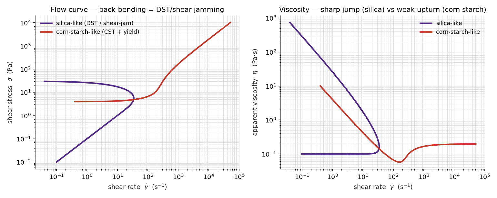
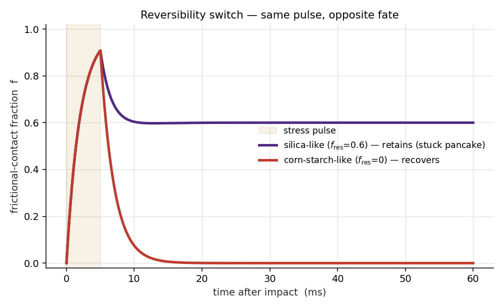

# tier0-closure — reduced-order shear-thickening rheology + drop-impact switch

A minimal, tested implementation of the **Wyart–Cates frictional-contact closure**
for dense suspensions, in the steady + state-variable form, built as the **Tier-0**
starting layer of the drop-impact simulation plan (see the vault's *Simulations MOC*).

Started 2026-07-16 (overnight, with Claude) as the "cheap sanity gate before any CFD"
that the Simulations MOC calls for.

## What it does

Two contrasts that the corn-starch-vs-silica drop-impact story hinges on, reproduced
from one closure with two parameter sets:

**Gate 1 — bulk rheology.** Silica-like parameters (packing in the shear-jamming
window `phi_m < phi < phi0`) give a **back-bending flow curve = DST / shear jamming**
(~7000× viscosity jump). Corn-starch-like parameters (below `phi_m`, plus an adhesive
yield stress) give a **continuous, weakly thickening yield fluid (CST)** — matching the
Slide-16 observation that this cornstarch prep shows CST, not DST.

**Gate 2 — reversibility switch.** Under an *identical* impact-strength stress pulse, a
material with an irreversible frictional network (residual latch, `f_res>0`) **retains**
its jammed microstructure after the stress is removed (a "stuck pancake" → deposition),
while a reversible material (`f_res=0`) **relaxes** (→ recovery / rebound). Same input,
opposite fate — the mechanism the drop-impact work attributes to silica vs corn starch.




## The model (see `wyart_cates.py` for the full docstring)

- Stress-activated frictional fraction `f_ss(σ) = exp(-(σ*/σ))`.
- Jamming fraction interpolates `phi_J(f) = (1-f)·phi0 + f·phi_m`.
- Relative viscosity diverges: `eta_r = (1 - phi/phi_J(f))^(-2)`.
- Memory / reversibility: `df/dt = (f_target - f)/tau`, with an irreversible
  activation latch giving a retained floor `f_target = max(f_ss, f_res·a)`.

All parameters are **illustrative** — chosen to reproduce the qualitative contrast.
The next step is to **calibrate** them against measured corn-starch and silica flow curves.

## Differentiable calibration (`diff_calibrate.py`)

A PyTorch-autodiff twin of the steady closure that **calibrates parameters by
gradient descent** instead of hand-tuning — the top simulation-frontier
recommendation, realised. It generates synthetic stress-controlled viscometry
from known TRUE parameters + lognormal noise, then recovers `(phi, phi_m,
sigma_star)` by backprop (Adam, log-space MSE). Ground-truth test passes:
recovered φ=0.520 (true 0.520), φ_m=0.559 (0.560), σ*=8.13 (8.0); loss gradient
~1e-10 at the optimum. Figure `diff_calibration.png` shows the fit + convergence.
The next step (JAX/`diffrax`) would extend autodiff *through the transient ODE*
too, and add uncertainty quantification.

## Run it

```
python run_sanity_gate.py     # prints PASS/FAIL report, writes the two PNGs
python test_wyart_cates.py    # 6 invariant tests (also runs under pytest)
python diff_calibrate.py      # differentiable calibration -> recovered params + figure
```

Requires `numpy`, `scipy`, `matplotlib`, `torch` (CPU is fine).

## Status / next steps (from the Simulations MOC)

- [x] Reproduce the DST-vs-yield bulk-rheology contrast as a sanity gate (Gate 1).
- [x] Encode the reversibility (retention-vs-recovery) switch (Gate 2).
- [ ] Calibrate `(phi, phi_m, sigma_star, sigma_yield, f_res, tau)` to real flow curves.
- [ ] Couple the closure into the existing Herschel–Bulkley Basilisk drop sim and check
      that `t_jam`, `r_jam`, and retention split in the right direction (Tier-0 macro).
- [ ] Add κ ∝ a² onset-timescale lever (silica jams ~15× earlier) as a second discriminator.

## Portfolio note

This is intended as a clean, self-contained portfolio piece (physics + numerics +
validation). Keep it that way: named constants, documented assumptions, tests for every
invariant, a figure that reads in 30 seconds.
